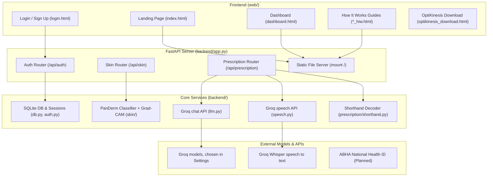

# Diagnosia — Master Project & Architecture Guide

> **AI tools that give India's doctors back their time, and give patients understanding and independence.**

This document provides a comprehensive technical and functional reference for the Diagnosia platform. It is designed to serve as the single source of truth for understanding the codebase, extending existing features, and planning future iterations.

---

## Table of Contents

1. [Executive Summary & Core Mission](#1-executive-summary--core-mission)
2. [End-to-End System Architecture](#2-end-to-end-system-architecture)
3. [Deep-Dive into the Four Core Tools](#3-deep-dive-into-the-four-core-tools)
   - [3.1 Skin Cancer Detection](#31-skin-cancer-detection)
   - [3.2 DiagnoFast (Voice-First Intake)](#32-diagnofast-voice-first-clinical-intake)
   - [3.3 Prescription Analyzer](#33-prescription-analyzer)
   - [3.4 OptiKinesis (Assistive Computing)](#34-optikinesis-hands-free-assistive-control)
4. [Backend Architecture & Data Layer](#4-backend-architecture--data-layer)
   - [Configuration & Environment](#configuration--environment)
   - [Database Schema & Session Management](#database-schema--session-management)
   - [Security & Cryptography](#security--cryptography)
   - [External AI & Speech Services](#external-ai--speech-services)
5. [Complete API Specification](#5-complete-api-specification)
6. [Frontend Architecture & Assets](#6-frontend-architecture--assets)
7. [Local Development, Running & Testing](#7-local-development-running--testing)
8. [Iteration Roadmap & High-Priority Tasks](#8-iteration-roadmap--high-priority-tasks)
9. [Codebase File & Directory Map](#9-codebase-file--directory-map)
10. [Legacy & Archived Components](#10-legacy--archived-components)

---

## 1. Executive Summary & Core Mission

### The Context
India's healthcare infrastructure operates under immense pressure. In public hospitals and rural clinics, patient-to-doctor ratios frequently exceed thousands to one. This creates three critical bottlenecks:
1. **Excessive Waiting Times & Brief Consultations:** Doctors spend 50–70% of a short 3-minute consultation repeating routine history-taking questions (*"What is the problem? Since when? What medications?"*).
2. **Late Diagnosis of Critical Conditions:** Lesions and pre-cancerous conditions are often overlooked because screening relies on scarce dermatologists or costly biopsies.
3. **Post-Visit Confusion & Non-Adherence:** Prescriptions are written in handwritten medical shorthand (`1-0-1`, `TDS`, `AC`, `HS`), resulting in patient confusion, incorrect dosing, and lack of follow-up.
4. **Physical Digital Barriers:** Individuals with severe motor disabilities (ALS, stroke, spinal cord injuries, cerebral palsy) cannot use standard mouse/keyboard hardware, and proprietary assistive eye-trackers cost lakhs of rupees.

### The Diagnosia Solution
Diagnosia reorganizes the clinical journey into 4 synchronized AI tools that assist—never replace—medical practitioners and empower patients:

```
  WAITING ROOM               DOCTOR'S CABIN                AT HOME / PHARMACY
┌──────────────────────┐   ┌────────────────────────┐   ┌────────────────────────┐
│      DiagnoFast      │   │   Doctor's Review      │   │  Prescription Analyzer │
│                      │   │   • Reads DiagnoFast   │   │                        │
│ • Voice intake       │──▶│     intake report      │──▶│ • Decodes shorthand    │
│ • Indian languages   │   │   • Runs Skin Cancer   │   │ • Daily schedule       │
│ • Ready-made summary │   │     screening if lesion│   │ • Diet, yoga & speech  │
└──────────────────────┘   └────────────────────────┘   └────────────────────────┘

              OptiKinesis (Universal Accessibility):
              Webcam-based head-tracking & blink clicking for patients
              who cannot use their hands.
```

---

## 2. End-to-End System Architecture



---

## 3. Deep-Dive into the Four Core Tools

### 3.1 Skin Cancer Detection
* **Purpose:** Provides a rapid, objective second opinion on dermatoscopic images before costly biopsies. Built strictly for doctors.
* **Underlying Model:** Built upon **PanDerm** (`panderm_large_patch16_224`), a foundation vision transformer (ViT) pre-trained on dermatological imagery.
* **8 Lesion Classes Handled:**
  | Code | Condition Name | Clinical Classification |
  |---|---|---|
  | `MEL` | Melanoma | Malignant (High Concern) |
  | `BCC` | Basal cell carcinoma | Malignant (High Concern) |
  | `SCC` | Squamous cell carcinoma | Malignant (High Concern) |
  | `AK` | Actinic keratosis | Pre-cancerous (High Concern) |
  | `BKL` | Benign keratosis-like lesion | Benign |
  | `DF` | Dermatofibroma | Benign |
  | `NV` | Melanocytic nevus (mole) | Benign |
  | `VASC` | Vascular lesion | Usually benign |

* **Key Files:**
  * [`backend/skin/conditions.py`](file:///Users/aditya1981/diagnosia/backend/skin/conditions.py): Class labels and `CONCERNING = {"MEL", "BCC", "SCC", "AK"}` set.
  * [`backend/skin/encoder.py`](file:///Users/aditya1981/diagnosia/backend/skin/encoder.py): Loads the PanDerm ViT feature extractor and sets up the standard 224x224 normalization pipeline.
  * [`backend/skin/classifier.py`](file:///Users/aditya1981/diagnosia/backend/skin/classifier.py): Logistic regression classifier on top of PanDerm 1024-d embeddings, equipped with:
    1. **Grad-CAM Attention Heatmap:** Computes token gradients entering the final transformer block and blends them into a 224x224 heatmap overlay.
    2. **Temperature Calibration:** Scales logits so confidence values represent true empirical probabilities.
    3. **Centroid-Based Out-of-Distribution Check:** Compares the image feature vector against training class centroids; images below the `familiar_floor` are flagged as `"uncertain"`.
    4. **Calibrated Referral Threshold:** Recommends `"refer"` vs `"monitor"` tuned to catch $\ge 95\%$ of concerning cases.
  * [`backend/skin/routes.py`](file:///Users/aditya1981/diagnosia/backend/skin/routes.py): Doctor-guarded API route (`POST /api/skin/analyze`).

---

### 3.2 DiagnoFast (Voice-First Clinical Intake)
* **Purpose:** Gathers patient history in the waiting room using voice conversation in Indian languages, populates the doctor's custom questionnaire, and provides a concise 1-page summary.
* **Indian Language Support:**
  * **Speech-to-Text (STT):** Groq Whisper, for Hindi (`hi-IN`) and Indian English (`en-IN`).
  * **Text-to-Speech (TTS):** Groq Orpheus for English, and the browser voice for Hindi.
* **Implementation Layer:** Located in [`backend/speech.py`](file:///Users/aditya1981/diagnosia/backend/speech.py) and [`backend/llm.py`](file:///Users/aditya1981/diagnosia/backend/llm.py).
* **ABHA Integration (Planned):** Secure retrieval of historical prescriptions and lab tests via the Ayushman Bharat Digital Mission (ABDM) sandbox.
* **Doctor Report Output:**
  * Patient vitals & chief complaint.
  * History of Present Illness (HPI) timeline.
  * Answers mapped to the doctor's custom intake form.
  * Current medications, allergies, and urgent red-flag highlights.
  * Audio playback link of the patient's original voice recording.

---

### 3.3 Prescription Analyzer
* **Purpose:** Translates complex, handwritten doctor prescriptions into actionable, structured patient guidance.
* **Two-Stage Safety Architecture:**
  1. **Transcription & Legibility Auditing:** The vision model reads the image and returns a typed [`ReadPrescription`](file:///Users/aditya1981/diagnosia/backend/prescription/analyzer.py#L62-L67) model where every field is categorized as `"clear"`, `"unsure"`, or `"unreadable"`.
  2. **Patient Confirmation & Guarded Explanation:** Only medicines marked readable and confirmed by the patient are processed for dietary, yoga, and scheduling guidance. Any unreadable entry triggers a strict *"Consult your pharmacist"* warning.
* **Deterministic Shorthand Engine ([`backend/prescription/shorthand.py`](file:///Users/aditya1981/diagnosia/backend/prescription/shorthand.py)):**
  * `1-0-1`, `1-1-1`, `½-0-½` $\rightarrow$ Morning / Afternoon / Night breakdown.
  * `OD` / `QD` $\rightarrow$ Once a day; `BD` / `BID` $\rightarrow$ Twice a day; `TDS` / `TID` $\rightarrow$ Three times a day; `QID` $\rightarrow$ Four times a day.
  * `AC` $\rightarrow$ Before food; `PC` $\rightarrow$ After food; `HS` $\rightarrow$ At bedtime; `SOS` / `PRN` $\rightarrow$ Only when needed.
  * `x 5 days`, `for 1 week`, `x 1 month` $\rightarrow$ Exact duration calculation.
* **Safety Rules Enforced by System Prompts:**
  * Never alter dosages, suggest brand swaps, or advise discontinuing medicines.
  * Diet, lifestyle, and yoga suggestions must be non-pharmacological, safe, and condition-compatible.
* **Key Files:**
  * [`backend/prescription/analyzer.py`](file:///Users/aditya1981/diagnosia/backend/prescription/analyzer.py)
  * [`backend/prescription/shorthand.py`](file:///Users/aditya1981/diagnosia/backend/prescription/shorthand.py)
  * [`backend/prescription/routes.py`](file:///Users/aditya1981/diagnosia/backend/prescription/routes.py)

---

### 3.4 OptiKinesis (Hands-Free Assistive Control)
* **Purpose:** Enables individuals with motor impairments (ALS, spinal cord injury, cerebral palsy, quadriplegia) to control an everyday computer using only a built-in webcam.
* **Core Technology:**
  * 478-point facial landmark tracking using MediaPipe Face Mesh.
  * Relative head pose calculation for smooth cursor movement with jitter dampening.
  * 5-point personalized calibration (Center, Top-Left, Top-Right, Bottom-Left, Bottom-Right).
  * Blink-to-click detector (filters out involuntary micro-blinks and prolonged natural eye rest).
  * On-screen accessibility keyboard with predictive text and voice-to-text.
  * Distraction-free web reader and emergency SOS trigger.
* **Distribution:** Packaged as a standalone Windows installer (`OptiKinesis-Setup.exe`) available on GitHub releases and linked on [`web/optikinesis_download.html`](file:///Users/aditya1981/diagnosia/web/optikinesis_download.html).

---

## 4. Backend Architecture & Data Layer

### Configuration & Environment
The backend configuration is centralized in [`backend/config.py`](file:///Users/aditya1981/diagnosia/backend/config.py) and reads from `.env`:

```python
# .env Configuration Keys
GROQ_API_KEY="your-groq-key"           # All AI and speech. Can also be added in Settings
DIAGNOSIA_HTTPS="0"                    # Set to 1 in production for secure cookies
DIAGNOSIA_DB="backend/storage/diagnosia.db"
DIAGNOSIA_AUDIO="backend/storage/audio"
```

### Database Schema & Session Management
SQLite is initialized automatically during application lifespan ([`backend/db.py`](file:///Users/aditya1981/diagnosia/backend/db.py)). Foreign key constraints are strictly enforced (`PRAGMA foreign_keys = ON`).

```sql
CREATE TABLE IF NOT EXISTS users (
    id INTEGER PRIMARY KEY,
    first_name TEXT NOT NULL,
    last_name TEXT NOT NULL,
    email TEXT NOT NULL UNIQUE,
    password_hash TEXT NOT NULL,
    role TEXT NOT NULL CHECK (role IN ('doctor', 'patient')),
    created_at TEXT NOT NULL DEFAULT (datetime('now'))
);

CREATE TABLE IF NOT EXISTS sessions (
    token_hash TEXT PRIMARY KEY,
    user_id INTEGER NOT NULL REFERENCES users (id) ON DELETE CASCADE,
    expires_at TEXT NOT NULL
);
```

### Security & Cryptography
* **Password Hashing:** Uses `argon2id` via the `argon2-cffi` library.
* **Constant-Time Fallback:** For non-existent email logins, a pre-computed `DUMMY_HASH` is evaluated to prevent user enumeration via timing analysis.
* **Session Cookie:** Stored in an `HttpOnly`, `SameSite=Lax` cookie named `diagnosia_session` (valid for 14 days). The database only stores `SHA-256(token)`, protecting user sessions against database leaks.
* **Zero Persistence for Scan Photos:** Neither skin lesion photos nor prescription images are saved to disk; images are validated in-memory via PIL and discarded immediately after processing. LabLens is the deliberate exception: original lab reports are stored so results stay traceable. They are encrypted: see [`docs/DATA_PROTECTION_AND_RETENTION.md`](docs/DATA_PROTECTION_AND_RETENTION.md).

### External AI & Speech Services
* **Structured Output:** Managed by `backend/llm.py`, through Groq. Models are chosen in Settings. See [`docs/PLATFORM_SETUP.md`](docs/PLATFORM_SETUP.md).
* **Speech:** Handled by `backend/speech.py`, using Groq Whisper and Orpheus. Hindi reading aloud uses the browser's voice.

---

## 5. Complete API Specification

All API routes are prefixed with `/api`. Interactive OpenAPI docs are intentionally disabled in production for privacy.

### Authentication Endpoints ([`backend/auth.py`](file:///Users/aditya1981/diagnosia/backend/auth.py))

| Endpoint | Method | Auth Required | Description | Request Payload / Params |
|---|---|---|---|---|
| `/api/auth/register` | `POST` | None | Create account (`doctor` or `patient`) | `{"first_name": "...", "last_name": "...", "email": "...", "password": "...", "role": "doctor"}` |
| `/api/auth/login` | `POST` | None | Authenticate & set session cookie | `{"email": "...", "password": "..."}` |
| `/api/auth/logout` | `POST` | Authenticated | Invalidate session & clear cookie | None |
| `/api/me` | `GET` | Authenticated | Return current user details | None |

### Skin Cancer Detection ([`backend/skin/routes.py`](file:///Users/aditya1981/diagnosia/backend/skin/routes.py))

| Endpoint | Method | Auth Required | Content-Type | Description |
|---|---|---|---|---|
| `/api/skin/analyze` | `POST` | `doctor` role | `multipart/form-data` | Uploads lesion image (`image`) and type (`image_type`: `"dermoscopic"` or `"phone"`). Returns ranked conditions, concern score, priority (`"refer"` / `"monitor"` / `"uncertain"`), Grad-CAM heatmap data URI, and optional phone photo warning. |

### Prescription Analyzer ([`backend/prescription/routes.py`](file:///Users/aditya1981/diagnosia/backend/prescription/routes.py))

| Endpoint | Method | Auth Required | Content-Type | Description |
|---|---|---|---|---|
| `/api/prescription/read` | `POST` | Any user | `multipart/form-data` | Uploads prescription photo (`image`) with explicit user `consent: bool`. Returns structured medications, shorthand translations, and legibility status. |
| `/api/prescription/explain` | `POST` | Any user | `application/json` | Accepts confirmed medicines and language (`"en-IN"` / `"hi-IN"`). Returns dietary advice, yoga, lifestyle tips, daily schedule, and pharmacist check items. |
| `/api/prescription/speak` | `POST` | Any user | `application/json` | Accepts `text` and `language`. Returns WAV audio bytes for English. Hindi is read by the browser. |

---

## 6. Frontend Architecture & Assets

The frontend is served directly as static files from the [`web/`](file:///Users/aditya1981/diagnosia/web) directory via FastAPI's `app.mount("/", StaticFiles(directory=WEB_DIR, html=True))`.

### Page Directory
* [`web/index.html`](file:///Users/aditya1981/diagnosia/web/index.html): Main landing page. Features hero header, four medical tool cards, value propositions, and expandable FAQ blocks.
* [`web/login.html`](file:///Users/aditya1981/diagnosia/web/login.html): Split tab interface for Login and Registration. Form submissions are handled asynchronously via [`web/js/auth.js`](file:///Users/aditya1981/diagnosia/web/js/auth.js).
* [`web/dashboard.html`](file:///Users/aditya1981/diagnosia/web/dashboard.html): User account profile showing role, ID, and session state. Handled by [`web/js/dashboard.js`](file:///Users/aditya1981/diagnosia/web/js/dashboard.js).
* [`web/skin_cancer_hiw.html`](file:///Users/aditya1981/diagnosia/web/skin_cancer_hiw.html): "How It Works" visual timeline for Skin Cancer Detection.
* [`web/diagnofast_hiw.html`](file:///Users/aditya1981/diagnosia/web/diagnofast_hiw.html): "How It Works" visual timeline for DiagnoFast voice intake.
* [`web/prescription_analyzer_hiw.html`](file:///Users/aditya1981/diagnosia/web/prescription_analyzer_hiw.html): "How It Works" visual timeline for Prescription Analyzer.
* [`web/optikinesis_hiw.html`](file:///Users/aditya1981/diagnosia/web/optikinesis_hiw.html): "How It Works" guide for webcam tracking and gesture calibration.
* [`web/optikinesis_download.html`](file:///Users/aditya1981/diagnosia/web/optikinesis_download.html): Windows installer download portal with hardware specs and user guide.
* [`web/terms_of_service.html`](file:///Users/aditya1981/diagnosia/web/terms_of_service.html): Privacy and clinical disclaimer terms.

---

## 7. Local Development, Running & Testing

### 1. Prerequisites
* Python 3.11 or Python 3.12 (Python 3.12 recommended).
* [`uv`](https://github.com/astral-sh/uv) (fast Python package manager) installed.

### 2. Environment Setup
```bash
# 1. Create the virtual environment using Python 3.12
uv venv .venv --python 3.12

# 2. Activate the virtual environment
source .venv/bin/activate

# 3. Install core web & backend dependencies
uv pip install -r backend/requirements.txt

# 4. Optional: Install scientific & training dependencies (pandas, scikit-learn)
uv pip install pandas scikit-learn

# 5. Create local environment configuration
cp .env.example .env
# Edit .env and supply GROQ_API_KEY if testing live AI calls, or add it in Settings
```

### 3. Running the Server
```bash
# Start FastAPI with live reload
.venv/bin/uvicorn backend.app:app --host 127.0.0.1 --port 8001 --reload
```
Navigate to **`http://127.0.0.1:8001/`** in your browser.

### 4. Running the Test Suite
The repository includes a comprehensive unit and integration test suite:
```bash
# Run all core tests (auth, prescription shorthand, external service mocks, site routing)
.venv/bin/pytest backend/tests/test_auth.py backend/tests/test_prescription.py backend/tests/test_services.py backend/tests/test_site.py -v
```
*(All 99 core unit tests execute in ~1.2s without requiring live third-party API keys).*

---

## 8. Iteration Roadmap & High-Priority Tasks

The table below outlines the highest-impact development tasks to take Diagnosia from prototype to full deployment:

### 🚀 Priority 1: Wire Up Frontend Interactive Modals
* **Skin Cancer Upload Tool:** Currently, [`web/skin_cancer_hiw.html`](file:///Users/aditya1981/diagnosia/web/skin_cancer_hiw.html) displays a static "coming soon" badge. 
  * *Task:* Implement a file dropzone for doctor accounts that POSTs to `/api/skin/analyze`, displays the predicted condition probabilities, and renders the Grad-CAM heatmap side-by-side with the uploaded photo.
* **Prescription Analyzer Upload Tool:** Currently, [`web/prescription_analyzer_hiw.html`](file:///Users/aditya1981/diagnosia/web/prescription_analyzer_hiw.html) is an explainer.
  * *Task:* Add an image capture interface that calls `/api/prescription/read`, renders a confirmation table with legibility indicators, calls `/api/prescription/explain`, and embeds an audio player for `/api/prescription/speak`.

### 🎙️ Priority 2: Build the DiagnoFast Intake Module
* **Backend Router (`backend/diagnofast/`):**
  * Create a conversational state-machine managing questions and voice note uploads.
  * Chain Whisper transcription $\rightarrow$ clinical extraction $\rightarrow$ JSON clinical summary.
* **Doctor Form Customizer:**
  * Create an admin interface allowing doctors to define custom history questions (e.g., pediatric vs dermatological templates).
* **Doctor Intake Dashboard:**
  * On [`web/dashboard.html`](file:///Users/aditya1981/diagnosia/web/dashboard.html), render incoming patient cards with one-line chief complaints, priority tags, and downloadable clinical intake PDFs.

### 🛡️ Priority 3: Skin Model Upgrades & Indian Skin Tone Diversity
* The public HAM10000 dataset predominantly features Caucasian/lighter skin types (Fitzpatrick types I–III).
* *Task:* Fine-tune the classification layer and calibrate temperature thresholds using diverse Fitzpatrick IV–VI datasets to ensure accurate lesion screening in Indian demographics.

### 🔐 Priority 4: ABDM / ABHA Sandbox Integration
* Implement consent-based patient lookup via ABDM APIs to auto-populate existing medical conditions and recent lab reports into DiagnoFast summaries.

---

## 9. Codebase File & Directory Map

```
diagnosia/
├── .env.example                               # Sample environment file
├── .gitignore                                 # Git ignore (weights, db, audio, venv)
├── PROJECT_DESCRIPTION.md                     # High-level product vision & narrative
├── PROJECT_DOCUMENTATION.md                   # THIS FILE: Master technical reference
├── README.md                                  # Original project readme
├── backend/
│   ├── app.py                                 # FastAPI application instance & lifespan
│   ├── auth.py                                # User registration, login, cookies & roles
│   ├── config.py                              # Dataclass settings & paths
│   ├── db.py                                  # SQLite connection & migration logic
│   ├── images.py                              # PIL upload validation (MIME, max bytes)
│   ├── llm.py                                 # Groq structured output client
│   ├── speech.py                              # Groq speech clients
│   ├── prescription/
│   │   ├── analyzer.py                        # Prescription OCR & guidance prompts
│   │   ├── routes.py                          # /api/prescription routes
│   │   └── shorthand.py                       # Regex shorthand decoding engine
│   ├── skin/
│   │   ├── classifier.py                      # PanDerm ViT inference & Grad-CAM heatmap
│   │   ├── conditions.py                      # 8 lesion codes, names, & risk categories
│   │   ├── encoder.py                         # ViT loader & normalization transforms
│   │   ├── routes.py                          # /api/skin routes
│   │   └── training/
│   │       ├── extract_features.py            # Offline PanDerm feature extraction
│   │       ├── prepare_split.py               # Patient-grouped train/val/test split
│   │       └── train_classifier.py            # Logistic regression + calibration training
│   └── tests/
│       ├── test_auth.py                       # Unit tests for user registration & sessions
│       ├── test_prescription.py               # Tests for shorthand regex & OCR pipelines
│       ├── test_services.py                   # Mock tests for the Groq APIs
│       ├── test_site.py                       # Static page serving & path traversal tests
│       └── test_skin.py                       # Tests for classification & thresholding
├── web/
│   ├── index.html                             # Homepage
│   ├── dashboard.html                         # Doctor/patient dashboard
│   ├── login.html                             # Authentication UI
│   ├── diagnofast_hiw.html                    # DiagnoFast explainer
│   ├── skin_cancer_hiw.html                   # Skin Cancer explainer
│   ├── prescription_analyzer_hiw.html         # Prescription Analyzer explainer
│   ├── optikinesis_hiw.html                   # OptiKinesis explainer
│   ├── optikinesis_download.html              # OptiKinesis Windows beta download
│   ├── terms_of_service.html                  # Terms & legal disclaimer
│   ├── css/index.css                          # Primary stylesheet
│   └── js/
│       ├── auth.js                            # Form handling for login & sign-up
│       ├── dashboard.js                       # Session checking & logout handler
│       └── index.js                           # Webflow animation runtime
├── pitch/                                     # Pitch decks, scripts & video assets
└── archive/                                   # Deprecated 2023 prototype code
```

---

## 10. Legacy & Archived Components

The [`archive/`](file:///Users/aditya1981/diagnosia/archive) folder houses previous experiments and discontinued components from Diagnosia's 2023 initial version. **None of these are served by the live site or used in production:**

* `archive/php/`: Legacy PHP authentication scripts. Discontinued due to insecure MD5 password storage and direct SQL concatenation vulnerabilities.
* `archive/skin_cancer/`: Deprecated Streamlit UI with older Keras H5 models. Replaced by [`backend/skin/`](file:///Users/aditya1981/diagnosia/backend/skin) with PanDerm.
* `archive/talkie/`: Deprecated conversational chatbot based on older Gemini versions.
* `archive/curl_counter/`: Discontinued workout counter feature.
* `archive/old_site/`: Early HTML templates for a BMI calculator and Google Maps doctor directory (`DocFinder`), removed to keep the product focused strictly on clinical triage and assistive technology.

---

## 11. The tools around the patient record

Eight add-on tools built on one shared patient record. **All are pilots, not validated for patient care:** see [`docs/CLINICAL_GOVERNANCE.md`](docs/CLINICAL_GOVERNANCE.md).

| Tool | Package | Routes | Guide |
|---|---|---|---|
| Shared record | `backend/records/` | `/api/patients`, `/api/tasks`, `/api/notifications`, `/api/organizations` | This section |
| ClinScribe | `backend/clinscribe/` | `/api/addons/clinscribe` | [`docs/addons/clinscribe.md`](docs/addons/clinscribe.md) |
| MedGuard | `backend/medguard/` | `/api/addons/medguard` | [`docs/addons/medguard.md`](docs/addons/medguard.md) |
| LabLens | `backend/lablens/` | `/api/addons/lablens` | [`docs/addons/lablens.md`](docs/addons/lablens.md) |
| ChronicCare | `backend/chroniccare/` | `/api/addons/chroniccare` | [`docs/addons/chroniccare.md`](docs/addons/chroniccare.md) |
| ReferralLoop | `backend/referralloop/` | `/api/addons/referrals` | [`docs/addons/referralloop.md`](docs/addons/referralloop.md) |
| DischargeCare | `backend/dischargecare/` | `/api/addons/dischargecare` | [`docs/addons/dischargecare.md`](docs/addons/dischargecare.md) |
| MaternaCare | `backend/maternacare/` | `/api/addons/maternacare` | [`docs/addons/maternacare.md`](docs/addons/maternacare.md) |
| AMR Guard | `backend/amrguard/` | `/api/addons/amrguard` | [`docs/addons/amrguard.md`](docs/addons/amrguard.md) |

* **Conventions:** each tool owns a `schema.sql`, picked up by `init_db()`. Primary keys are UUIDs. Every route enters a patient through `records.access.open_patient`, which checks the care team and writes the audit log.
* **Frontend:** `web/care.html` with one ES module per tool in `web/js/care/`. All page content goes through `h()` and `show()`, so data can never become markup. The page has no analytics.
* **Review rule:** anything no person has checked is highlighted in yellow, and stays out of the record, the timeline and FHIR exports until reviewed.
