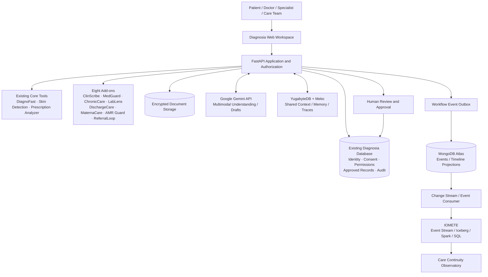
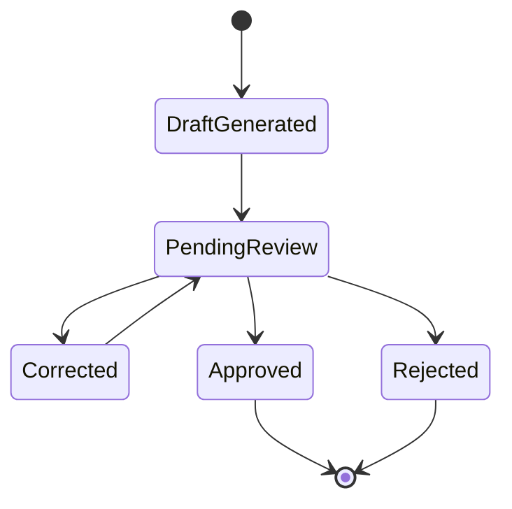

<p align="center">
  
</p>

<h1 align="center">Diagnosia</h1>

<p align="center">
  <strong>AI-powered care continuity for safer, more connected healthcare.</strong><br />
  A modular healthcare workspace connecting clinical information, specialist workflows, shared agent context and operational intelligence.
</p>

<p align="center">
  
  
  
  
</p>

<p align="center">
  <a href="#overview">Overview</a> ·
  <a href="#the-eight-add-ons">Eight Add-ons</a> ·
  <a href="#the-four-sponsor-integrations">Sponsor Integrations</a> ·
  <a href="#architecture">Architecture</a> ·
  <a href="#getting-started">Getting Started</a> ·
  <a href="#safety-and-readiness">Safety & Readiness</a>
</p>

> [!CAUTION]
> **PILOT ONLY — NO-GO FOR REAL PATIENTS.** Diagnosia is a development and hackathon prototype. Use synthetic data only. It is not approved for diagnosis, treatment decisions, clinical deployment or storage of real patient information. Passing software tests does not establish clinical validity, regulatory compliance or production security.

---

## Contents

- [Overview](#overview)
- [The problem](#the-problem)
- [Product scope](#product-scope)
- [Core Diagnosia tools](#core-diagnosia-tools)
- [The eight add-ons](#the-eight-add-ons)
- [The four sponsor integrations](#the-four-sponsor-integrations)
- [How the technologies work together](#how-the-technologies-work-together)
- [Architecture](#architecture)
- [End-to-end demonstration](#end-to-end-demonstration)
- [Data ownership and review lifecycle](#data-ownership-and-review-lifecycle)
- [Technology stack](#technology-stack)
- [Getting started](#getting-started)
- [Configuration](#configuration)
- [Running and testing](#running-and-testing)
- [Security and safety boundaries](#security-and-safety-boundaries)
- [Current readiness and known limitations](#current-readiness-and-known-limitations)
- [Project documentation](#project-documentation)
- [Final scope and contribution boundaries](#final-scope-and-contribution-boundaries)
- [Sponsor and technical references](#sponsor-and-technical-references)

---

## Overview

**Diagnosia is a connected healthcare workflow platform designed to help clinicians, specialists, patients and care teams manage information across the patient journey.** It brings patient intake, medical-document understanding, clinical documentation, medication review workflows, laboratory reports, chronic-care follow-ups, discharge coordination, maternal-care coordination and specialist referrals into one shared patient-record experience.

The project combines three core clinical tools with eight integrated add-on modules. For the MLH hackathon scope, four sponsor technologies extend the platform in clearly separated roles:

| Sponsor technology | Responsibility in Diagnosia |
|---|---|
| **Google Gemini API** | Multimodal understanding, structured extraction, summarization and controlled requests to existing backend functions |
| **YugabyteDB + Meko** | Shared context, agent memory, workflow handoffs and execution traces |
| **MongoDB Atlas** | Flexible workflow events and patient-journey timeline projections |
| **IOMETE** | Lakehouse analytics over minimized operational events using Iceberg, Spark and SQL |

The goal is not to create a collection of disconnected AI demos. Diagnosia is designed as one coordinated system: information enters through existing workflows, AI prepares reviewable drafts, authorized modules reuse relevant context, workflow events update the patient journey, and aggregated operational data helps clinics understand where coordination is getting delayed.

### At a glance

| | |
|---|---|
| **Product category** | Healthcare workflow and care-continuity platform |
| **Primary users** | Doctors, specialists, patients and care teams |
| **Core tools** | DiagnoFast, Skin Cancer Detection, Prescription Analyzer |
| **Add-on modules** | 8 focused workflows |
| **Accessibility companion** | OptiKinesis (separate assistive-computing application) |
| **Hackathon integrations** | Gemini API, YugabyteDB + Meko, MongoDB Atlas, IOMETE |
| **Backend foundation** | Python, FastAPI and the existing Diagnosia data/authentication layer |
| **Frontend** | HTML, CSS and JavaScript served by FastAPI |
| **Demo data policy** | Synthetic data only |
| **Readiness** | Pilot prototype; not approved for real-patient use |

## The problem

Healthcare information is fragmented across short consultations, handwritten prescriptions, laboratory documents, hospital discharge papers, specialist referrals and follow-up reminders. Even when individual tools work, the overall patient journey can still lose context between visits and care settings.

Diagnosia focuses on four connected problems:

1. **Information capture:** patient history and supporting documents need to be collected in a usable, structured format.
2. **Clinical workflow fragmentation:** notes, laboratory reports, prescriptions, referrals and care tasks are often handled in separate workflows.
3. **Continuity gaps:** follow-ups, discharge tasks and referrals can remain incomplete or unconfirmed.
4. **Operational visibility:** care teams need to understand review backlogs and workflow delays without turning operational analytics into unsupported clinical decisions.

Diagnosia is intended to assist and coordinate these workflows. It does not replace clinicians, pharmacists, laboratory professionals or other qualified healthcare staff.

## Product scope

The project scope is now **feature-frozen**. The final product consists of:

- The existing core Diagnosia tools.
- The eight selected add-on modules described below.
- The four selected sponsor integrations.
- Shared platform capabilities required to connect, secure, observe and demonstrate those modules.
- One shared operational analytics view: the **Care Continuity Observatory**.

The Care Continuity Observatory is a platform-level analytics surface, **not a ninth clinical add-on**. No additional standalone healthcare tools are planned. Remaining development should focus on implementing the finalized integrations, closing technical gaps, validating existing workflows, improving reliability, documentation and review evidence—not expanding the product scope.

> **Implementation-status note:** the eight add-ons have been built into Diagnosia and exercised end to end as pilots. The four sponsor technologies below describe the finalized integration scope and intended responsibilities. Do not describe a sponsor integration as fully implemented until the repository contains the integration and a working end-to-end test or demo proves it.

## Core Diagnosia tools

These are the existing primary user-facing capabilities that form the foundation for the add-on workflows.

<details open>
<summary><strong>1. DiagnoFast — voice-first patient intake</strong></summary>

DiagnoFast helps collect a patient's history before or during a clinical visit. It is designed around conversational intake and structured preparation for the clinician.

**Existing workflow and technology**

- Voice-first patient history capture.
- Existing Sarvam AI speech-to-text integration using the Saaras model family.
- Existing Sarvam AI text-to-speech integration using the Bulbul model family.
- AI-assisted extraction into structured intake fields and a concise clinician-facing draft.
- Intended support for Hindi and Indian English workflows.

**Final sponsor integration**

Gemini may structure a synthetic transcript and supporting documents into a reviewable intake draft. Meko can make approved workflow context available to authorized downstream modules. Atlas can record intake and review lifecycle events; IOMETE can analyze intake-review throughput.

**Boundary:** patient statements remain patient-reported information until reviewed. DiagnoFast does not independently diagnose, triage or prescribe.
</details>

<details open>
<summary><strong>2. Skin Cancer Detection — image-based screening support</strong></summary>

The existing skin-image workflow uses a PanDerm-based visual representation with a classifier for eight lesion categories:

- Melanoma (`MEL`)
- Basal cell carcinoma (`BCC`)
- Squamous cell carcinoma (`SCC`)
- Actinic keratosis (`AK`)
- Benign keratosis-like lesion (`BKL`)
- Dermatofibroma (`DF`)
- Melanocytic nevus (`NV`)
- Vascular lesion (`VASC`)

The documented pipeline includes image preprocessing, classifier output, Grad-CAM visualization, calibration and out-of-distribution uncertainty handling. The workflow is intended for clinician review, not standalone patient diagnosis.

**Final sponsor integration:** preserve the existing model boundary. Gemini must not replace or overrule the skin model, generate a second unvalidated diagnosis or turn a model output into a clinical decision. Atlas/IOMETE may receive minimized workflow-status events only.

**Boundary:** this module has an unresolved calibration test failure and requires a CDSCO/regulatory assessment and appropriate clinical validation before any real-world use.
</details>

<details open>
<summary><strong>3. Prescription Analyzer — prescription understanding and guidance</strong></summary>

The Prescription Analyzer helps interpret prescription images and explain readable instructions in a patient-friendly format.

**Existing safety design**

- Extracted fields are classified as `clear`, `unsure` or `unreadable`.
- A deterministic shorthand engine interprets common notation such as `1-0-1`, `OD`, `BD`, `TDS`, `AC`, `PC`, `HS` and `SOS`.
- The patient confirms candidate medication information before downstream explanation.
- Unclear instructions are surfaced for pharmacist/doctor confirmation.
- The system must not silently alter a dose, substitute a brand or recommend stopping a medication.

**Final sponsor integration:** Gemini can be evaluated as an additional document-understanding path on synthetic prescription images. Its output remains a candidate draft; the deterministic parser, confirmation workflow and human review remain in control.

**Boundary:** model extraction is not a verified prescription or medication order.
</details>

### OptiKinesis — accessibility companion

OptiKinesis is a related but separately distributed assistive-computing application. It uses webcam-based head tracking and blink interaction to help people with motor impairments control a computer. The documented technology includes MediaPipe facial landmarks, head-pose mapping, calibration, blink-to-click interaction and accessibility controls.

OptiKinesis is **not counted among the eight Diagnosia clinical add-ons** and is not a diagnostic module. Its role in the broader project ecosystem is digital accessibility and hands-free computer interaction.

## The eight add-ons

The eight add-ons share the Diagnosia patient-record and workflow foundation. They are designed to exchange relevant, permission-controlled context rather than act as eight unrelated applications.

| Add-on | Purpose | Main users | Primary output |
|---|---|---|---|
| **ClinScribe** | Clinical documentation and encounter summarization | Doctor, clinician | Structured note draft with source references and review state |
| **MedGuard** | Medication reconciliation and safety-review workflow | Doctor, pharmacist | Reconciliation result and review workflow; approved interaction decision support is currently unavailable |
| **ChronicCare** | Longitudinal care plans and follow-up tracking | Patient, care team | Care tasks, reminders and follow-up status |
| **LabLens** | Laboratory report extraction and review | Patient, doctor, lab reviewer | Structured report draft with source and uncertainty metadata |
| **DischargeCare** | Discharge transition and post-discharge coordination | Hospital team, patient, care team | Discharge summary and candidate follow-up tasks |
| **MaternaCare** | Maternal and postnatal care coordination | Patient, maternal-health team | Care timeline, reviewed information and follow-up tasks |
| **AMR Guard** | Antimicrobial stewardship workflow coordination | Stewardship team, clinician | Administrative review status; clinical recommendation capability is unavailable |
| **ReferralLoop** | Specialist referrals and back-referral tracking | Referring doctor, specialist, care team | Referral status, appointment/consultation milestones and returned-note tracking |

<details>
<summary><strong>ClinScribe — AI clinical documentation</strong></summary>

ClinScribe turns clinician-entered information (text or voice transcript) into a structured encounter-note draft. Its role is to reduce repetitive documentation while keeping the clinician responsible for the final note.

**Planned Gemini/Meko/Atlas connections:** Gemini structures the supplied note content; Meko retrieves relevant, authorized prior workflow context; Atlas records draft, review and finalization events; IOMETE measures documentation turnaround and outstanding review volume.

**Guardrail:** generated text stays a draft until the clinician reviews and approves it. The system must not invent an examination finding, diagnosis or treatment plan.
</details>

<details>
<summary><strong>MedGuard — medication reconciliation and safety workflow</strong></summary>

MedGuard organizes medication information from available sources, highlights discrepancies for review and provides a workflow for pharmacist/clinician assessment.

**Current pilot limitation:** all 21 starter medication rules are unapproved. MedGuard therefore performs **no authoritative drug-interaction checks**. A missing alert must never be interpreted as evidence that a medication is safe. RxNorm and openFDA lookups are informational suggestions, not a complete or validated safety engine.

**Planned Gemini/Meko/Atlas/IOMETE connections:** Gemini may explain a pharmacist-approved finding in plain language; Meko can retrieve medication-source history and prior review status; Atlas records reconciliation events; IOMETE measures workflow volume and review completion—not medication safety.

**Guardrail:** do not create, activate or imply approval of medication rules without qualified pharmacist review.
</details>

<details>
<summary><strong>ChronicCare — longitudinal care coordination</strong></summary>

ChronicCare supports continuity through care plans, follow-up tasks, reminders and patient/care-team progress tracking.

**Planned sponsor connections:** Meko supplies authorized workflow context; Atlas stores task and reminder lifecycle events; IOMETE analyzes overdue tasks and completion patterns; Gemini may prepare patient-friendly explanations of already reviewed care-plan information.

**Guardrail:** it is not a new disease-risk predictor or autonomous treatment planner.
</details>

<details>
<summary><strong>LabLens — laboratory report digitisation and review</strong></summary>

LabLens extracts laboratory report content into structured, reviewable fields. The workflow is designed to retain the original source, preserve test names and values, and expose uncertainty for human correction.

**Planned sponsor connections:** Gemini provides multimodal PDF understanding for synthetic reports; Meko supports authorized continuity between LabLens and ClinScribe/ChronicCare; Atlas stores extraction and review events; IOMETE measures report-review backlog and turnaround.

**Current pilot limitations:** the parser has been exercised against synthetic layouts, not a representative real-world Indian laboratory dataset. The reported synthetic test set found 37/37 expected tests, but that is not a real-world accuracy claim. None of the 58 proposed LOINC mappings is approved; exports retain the laboratory's own test name rather than presenting an unreviewed mapping as verified.

**Guardrail:** extracted values remain drafts until reviewed. Do not infer missing values or silently normalize uncertain units.
</details>

<details>
<summary><strong>DischargeCare — discharge and transition coordination</strong></summary>

DischargeCare organizes discharge information and candidate post-discharge tasks so that a transition from hospital to home or another care setting has traceable next steps.

**Planned sponsor connections:** Gemini structures synthetic discharge documents into candidate tasks; Meko makes approved discharge context available to ChronicCare and ReferralLoop; Atlas records task lifecycle events; IOMETE analyzes completion and delay patterns.

**Guardrail:** extracted tasks require human verification before becoming active care tasks. Summarization is not a substitute for discharge instructions or clinical review.
</details>

<details>
<summary><strong>MaternaCare — maternal and postnatal coordination</strong></summary>

MaternaCare provides a workflow for maternal-care timelines, appointments, reminders and follow-up coordination.

**Planned sponsor connections:** Gemini may simplify clinician-approved instructions; Meko supports authorized workflow continuity; Atlas records reminder and follow-up states; IOMETE reports operational completion patterns.

**Current pilot limitation:** maternal clinical content is intentionally empty pending qualified maternal-health partners. Reminders are currently in-app/staff-follow-up workflows; SMS and automated voice delivery are not connected.

**Guardrail:** no unreviewed maternal risk scoring, diagnosis, treatment advice or autonomous escalation.
</details>

<details>
<summary><strong>AMR Guard — antimicrobial stewardship workflow</strong></summary>

AMR Guard represents the administrative and review coordination side of antimicrobial stewardship, such as recording that a review is required or tracking its completion.

**Current pilot limitation:** clinical decision support is unavailable. The recommendation route has been removed/disabled, and the module must not recommend antibiotics, doses, substitutions or treatment choices.

**Planned sponsor connections:** Meko may retrieve approved stewardship workflow guidance; Atlas records review status; IOMETE analyzes administrative review throughput. Gemini must not generate antibiotic recommendations.
</details>

<details>
<summary><strong>ReferralLoop — specialist referral and back-referral tracking</strong></summary>

ReferralLoop tracks a referral from request through routing, scheduling, specialist encounter and return of a consultation note. It focuses on coordination and preventing referrals from silently falling through workflow gaps.

**Planned sponsor connections:** Meko supports context handoffs between referring and receiving teams; Atlas maintains the referral timeline; IOMETE analyzes completion, turnaround and pending-referral patterns; Gemini may summarize referral documents as drafts.

**Guardrail:** referral urgency and clinical appropriateness remain decisions for qualified clinicians. Workflow analytics must not silently prioritize or deprioritize patients.
</details>

## The four sponsor integrations

These are the **final sponsor-track integrations** selected for the project. Each has one primary responsibility. They should not duplicate the role of the existing Diagnosia database or of one another.

### 1. Google Gemini API — multimodal intelligence

**Role:** understand incoming information and prepare structured, evidence-linked drafts inside existing workflows.

**Where it fits**

- **DiagnoFast:** structure synthetic patient transcripts and identify missing intake fields.
- **LabLens:** understand synthetic laboratory PDFs, including tables and visual layout; return candidate test names, values, units, reference ranges and source-page references.
- **Prescription Analyzer:** provide an additional synthetic-image extraction path while preserving `clear` / `unsure` / `unreadable` states.
- **ClinScribe:** organize clinician-provided content into a structured note draft.
- **DischargeCare:** extract candidate follow-up tasks from synthetic discharge documents.
- **Other add-ons:** explain only already-approved workflow information in accessible language; do not create new clinical rules.

**Controlled function calling**

Gemini may request a permitted backend function, such as retrieving a timeline or pending task list. The backend—not the model—must authenticate the user, verify patient/case scope, check consent, validate arguments and execute the operation. Model-supplied IDs or roles are never trusted as authorization.

**Demo proof:** show a real Gemini request using synthetic input, structured output validation, source provenance, uncertainty and a visible pending-review state.

### 2. YugabyteDB + Meko — shared context engine

**Role:** provide shared, retrievable context so authorized agents can continue a workflow without independently reconstructing every earlier step.

**Where it fits**

- Shared case context across the eight add-ons.
- Agent-to-agent handoffs, for example LabLens → ClinScribe → ChronicCare.
- Retrieval of prior workflow events, source references and human review decisions.
- Shared operational knowledge for approved workflow conventions.
- Agent conversation and tool-execution traces for demo observability.

**Important boundary:** Meko is the context/memory layer, not the authoritative patient database, consent engine or access-control system. Diagnosia must check permissions before retrieving or supplying context. Memory is a convenience for continuity; important clinical facts must be re-fetched from the authoritative record and revalidated.

**Demo proof:** one module writes an authorized synthetic case context item and another module retrieves it to continue a task. Show the handoff and relevant Meko trace. Confirm with the organizers whether their Yugabyte track requires an additional direct YugabyteDB interaction beyond the Meko-managed integration.

### 3. MongoDB Atlas — patient journey and workflow events

**Role:** store flexible workflow events and read-optimized timeline projections for the synthetic patient journey.

Suggested event types include:

- `intake_submitted`
- `lab_report_uploaded`
- `lab_extraction_created`
- `review_requested`
- `review_completed`
- `clinical_note_drafted`
- `referral_created`
- `referral_status_changed`
- `reminder_scheduled`
- `follow_up_completed`
- `discharge_task_created`

Use MongoDB Change Streams to detect relevant collection changes and notify the timeline/analytics pipeline. Use an outbox or retryable event-publishing pattern to avoid losing events when the primary application database and Atlas are temporarily out of sync.

**Important boundary:** Atlas is not a competing patient identity or approved-clinical-record database. The existing Diagnosia database remains authoritative for accounts, patient identity, care-team relationships, consent, permissions and approved clinical records. Store only the minimum workflow fields required for the Atlas timeline. Do not send real patient information to a hackathon Atlas environment.

**Demo proof:** a real write to Atlas, a query showing the event in the patient timeline, and a Change Stream consumer reacting to the event.

### 4. IOMETE — Care Continuity Observatory

**Role:** analyze minimized operational events at clinic/workflow level, rather than perform transactional patient-record operations.

**Proposed analytical pipeline**

1. Diagnosia emits a workflow event.
2. Atlas stores the workflow event/projection.
3. A consumer forwards a minimized, synthetic or properly de-identified event to IOMETE.
4. IOMETE Event Stream ingests the event into an Apache Iceberg table.
5. Spark jobs or SQL queries aggregate the data.
6. The Care Continuity Observatory displays the resulting operational metrics.

**Potential metrics**

- Referral completion and turnaround time.
- Laboratory report review backlog and turnaround.
- Clinical note draft-to-review time.
- Follow-up task completion and overdue counts.
- Discharge follow-up workflow completion.
- Reminder delivery and staff-contact outcomes.
- Administrative stewardship review throughput.

Metrics must state their date range, denominator and sample size. Avoid presenting percentages based on tiny synthetic samples as clinical or population-level conclusions.

**Important boundary:** IOMETE is an analytical layer, not a transactional patient-record store or a clinical risk-scoring engine. Use aggregated or minimized synthetic events; never use the analytics layer to make autonomous clinical decisions.

**Demo proof:** show an ingested event in an Iceberg table, a Spark/SQL transformation and a dashboard metric changing after a new synthetic event arrives.

### Track-to-module integration matrix

| Existing module | Gemini API | YugabyteDB + Meko | MongoDB Atlas | IOMETE |
|---|---|---|---|---|
| DiagnoFast | Structure transcript/intake drafts | Share approved intake context | Intake lifecycle events | Intake-review throughput |
| Skin Cancer Detection | No diagnostic replacement | Workflow references only | Minimized review-state events | Operational counts only |
| Prescription Analyzer | Alternate synthetic extraction | Medication-review context | Extraction/confirmation events | Workflow throughput only |
| ClinScribe | Note draft and summary | Retrieve prior authorized context | Draft/review/final events | Documentation backlog |
| MedGuard | Explain approved findings only | Medication-source/review context | Reconciliation events | Review workflow metrics |
| ChronicCare | Explain reviewed plans | Follow-up continuity context | Task/reminder events | Overdue/completion trends |
| LabLens | Multimodal report extraction | Cross-module report context | Extraction/review events | Report-review backlog |
| DischargeCare | Discharge summary/task draft | Handoff to ChronicCare/ReferralLoop | Discharge task events | Post-discharge workflow trends |
| MaternaCare | Simplify approved instructions | Authorized continuity context | Reminder/follow-up states | Operational completion only |
| AMR Guard | No antibiotic recommendation | Approved workflow references only | Review/unavailable states | Administrative throughput only |
| ReferralLoop | Summarize referral documents | Referrer/specialist handoff context | Referral lifecycle | Referral completion/turnaround |

## How the technologies work together

The integration is intentionally separated into an intelligence layer, context layer, workflow-event layer and analytics layer:

1. **Gemini understands:** interprets a synthetic document or transcript and returns structured candidate information.
2. **Diagnosia validates:** checks schema, provenance, user permissions and workflow rules; saves the result as a draft.
3. **Meko carries context:** an authorized downstream module retrieves relevant prior workflow context and execution history.
4. **MongoDB records the journey:** a workflow event updates the synthetic case timeline.
5. **IOMETE analyzes operations:** a minimized event is ingested and aggregated for clinic-level analytics.
6. **A human reviews:** clinical content remains pending until an authorized person reviews and approves it.

## Architecture



### Data ownership rules

| Data category | Authoritative owner | Role of sponsor technology |
|---|---|---|
| Accounts, sessions, staff verification | Existing Diagnosia database | No sponsor database becomes the identity authority |
| Patient identity, consent and care-team access | Existing Diagnosia database | Meko/Atlas/IOMETE must not override access decisions |
| Approved clinical records and audit events | Existing Diagnosia database | Gemini creates drafts; Meko supplies context; Atlas holds workflow projections; IOMETE analyzes minimized events |
| Original clinical document | Diagnosia encrypted document storage | Do not treat Gemini, Meko, Atlas or IOMETE as the document vault |
| Shared agent context | Meko, bounded by Diagnosia authorization | Context retrieval and agent handoffs |
| Workflow timeline | MongoDB Atlas projection | Flexible event persistence and Change Streams |
| Aggregated operational analytics | IOMETE Iceberg tables/views | Large-scale analytical processing |
| AI inference | Gemini API | Inference only; no authority to approve clinical records |

### Why the separation matters

Putting the same patient data into every system would create conflicting sources of truth, duplicate retention obligations, difficult deletion workflows and more places where sensitive data could be exposed. Each system therefore has one defined responsibility. The existing Diagnosia database remains the authority for identity and approved records; the sponsor systems extend context, event tracking and analytics.

## End-to-end demonstration

The recommended hackathon demo uses one clearly synthetic case, for example `CASE-DEMO-001`.

<details open>
<summary><strong>Step 1 — Intake and document understanding</strong></summary>

A demo patient submits a synthetic symptom transcript and a synthetic laboratory PDF through existing DiagnoFast/LabLens workflows. Gemini returns a structured draft with source-page references, uncertainty and schema version. The backend validates it and marks it `pending_review`.

**Show:** the Gemini request, structured response, extracted fields, source evidence and draft status.
</details>

<details>
<summary><strong>Step 2 — Human review and context creation</strong></summary>

The demo clinician accepts, corrects or rejects candidate fields. Diagnosia records the review in its authoritative audit trail. Only the permitted synthetic workflow facts are placed into the Meko context workspace.

**Show:** the original source next to the draft, the review action and the Meko context write.
</details>

<details>
<summary><strong>Step 3 — Cross-agent handoff</strong></summary>

ClinScribe starts an encounter draft and retrieves relevant context through Meko. It also fetches current approved workflow information from Diagnosia services; Meko memory is not treated as final clinical truth. The clinician reviews the generated draft.

**Show:** a real context retrieval, agent/tool trace, source references and the draft-to-review transition.
</details>

<details>
<summary><strong>Step 4 — Patient journey timeline</strong></summary>

Diagnosia publishes a workflow event through a retryable outbox process. MongoDB Atlas stores the event. The timeline projection displays the new activity, and a Change Stream consumer receives the event.

**Show:** Atlas document, timeline query and Change Stream event.
</details>

<details>
<summary><strong>Step 5 — Clinic operations analytics</strong></summary>

The consumer forwards a minimized synthetic event to IOMETE. IOMETE writes it to Iceberg; Spark or SQL aggregates the workflow data; the Care Continuity Observatory refreshes a metric such as pending report reviews or referral turnaround.

**Show:** ingestion result, Iceberg table, SQL/Spark query and updated dashboard.
</details>

<details>
<summary><strong>Step 6 — Safety and traceability</strong></summary>

The clinician opens the case timeline and can distinguish AI drafts from reviewed records. The demo shows source references, reviewer identity, audit events and the Meko execution trace. No unreviewed result is represented as an approved clinical fact.

**Show:** review status, provenance and access/audit trail.
</details>

## Data ownership and review lifecycle

All AI-generated clinical content follows a review lifecycle. The exact state names should match the implementation, but the conceptual process is:



- **Draft generated:** model output is stored with provider, timestamp, model/version where available, source reference and extraction metadata.
- **Pending review:** the UI clearly marks the information as unreviewed.
- **Corrected:** a human edits a candidate field; the correction remains attributable.
- **Approved:** an authorized reviewer accepts the information under the existing workflow.
- **Rejected:** an unsuitable or incorrect draft is retained/handled according to the applicable audit and retention policy, not silently promoted.

The current implementation reports that unreviewed material is highlighted and excluded from the approved record and FHIR exports. Keep this backend-enforced; a frontend badge alone is not a safety control.

## Technology stack

The following separates the documented existing foundation from the selected sponsor integration scope.

| Layer | Technology | Responsibility |
|---|---|---|
| Backend API | Python, FastAPI | Application endpoints, workflow orchestration and authorization |
| Data validation | Pydantic | Request/response schemas and validation |
| Existing database | SQLite in the documented development setup; configured through `DIAGNOSIA_DB` | Existing accounts, sessions and patient/workflow records |
| ORM/data access | SQLAlchemy and existing database layer | Persistence and relationships |
| Frontend | HTML, CSS, JavaScript | Landing pages, auth, dashboards and care workspace |
| Clinical image pipeline | PanDerm-based visual representation, PyTorch and scikit-learn classifier components | Existing skin-image workflow |
| Language model integrations | Existing Anthropic integration; selected Google Gemini API scope | Structured extraction, drafting and multimodal understanding |
| Speech | Sarvam AI Saaras STT and Bulbul TTS | Existing Indian-language voice workflow |
| Context engine | YugabyteDB + Meko | Shared agent context, memory and traces |
| Workflow event store | MongoDB Atlas | Flexible events and patient-journey projections |
| Analytics | IOMETE, Apache Iceberg, Spark and SQL | Operational workflow analytics |
| Document protection | AES-256-GCM encrypted document storage | Protect uploaded reports and documents at rest |
| Authentication security | Argon2id password hashing, hashed session tokens and HttpOnly cookies | Credential and session protection |

Exact versions and final deployment topology should be taken from the repository's dependency and environment files rather than inferred from this overview.

## Getting started

> These instructions describe the documented local development setup. Use synthetic data only. Some optional integrations require credentials and a configured service endpoint.

### Prerequisites

- Python 3.12 recommended (Python 3.11 may be supported by the project dependencies).
- [`uv`](https://docs.astral.sh/uv/) for Python environment and dependency management.
- Git.
- A browser such as Chrome for the local workspace.
- Optional API/service credentials for integrations being tested.

### 1. Clone the repository

Replace the placeholder with the repository URL provided by the project owner.

```bash
git clone <YOUR_DIAGNOSIA_REPOSITORY_URL>
cd diagnosia
```

### 2. Create the environment and install dependencies

```bash
uv venv .venv --python 3.12
source .venv/bin/activate
uv pip install -r backend/requirements.txt
```

On Windows PowerShell, activate the environment with:

```powershell
.venv\Scripts\Activate.ps1
```

### 3. Configure environment variables

```bash
cp .env.example .env
```

Open `.env` and configure only the services required for the workflow you are testing. See [Configuration](#configuration). Never commit `.env`, API keys, database credentials or document-encryption keys.

### 4. Generate the document-encryption key

Document uploads require the configured encryption key. Generate a local key file using the operator CLI:

```bash
.venv/bin/python -m backend.operator_cli generate-key --path ~/.diagnosia/document-keys.json
```

Set `DIAGNOSIA_DOCUMENT_KEY_FILE` in `.env` to that file path. Store a protected backup separately from the repository and test the recovery procedure. **Losing the key can make encrypted documents permanently unreadable.** Do not share the key or add it to Git.

Uploads should fail closed when the key is missing or invalid.

### 5. Bootstrap the first organization administrator

Public doctor registration does not make a staff account verified. The first organization administrator must be provisioned through the documented server-side operator workflow.

Inspect the available commands and their exact arguments with:

```bash
.venv/bin/python -m backend.operator_cli --help
.venv/bin/python -m backend.operator_cli bootstrap-organization --help
```

Follow the operator documentation in the repository. Do not invent or bypass staff verification.

### 6. Start Diagnosia

```bash
.venv/bin/uvicorn backend.app:app --host 127.0.0.1 --port 8001 --reload
```

Open the local care workspace:

**[http://127.0.0.1:8001/care.html](http://127.0.0.1:8001/care.html)**

The landing page is available at `http://127.0.0.1:8001/` when served by the documented static frontend setup.

## Configuration

The environment file is local-only. The following keys are documented in the existing project material; check `.env.example` and `backend/config.py` for the exact current supported names and defaults.

| Variable | Purpose | Notes |
|---|---|---|
| `ANTHROPIC_API_KEY` | Existing Claude integration | Do not send real patient data; vendor approval is outstanding |
| `LLM_MODEL` | Existing language-model selection | Use a model explicitly configured and approved for the synthetic pilot |
| `SARVAM_API_KEY` | Existing speech-to-text and text-to-speech | Live Sarvam use with patient data is not approved |
| `DIAGNOSIA_HTTPS` | Secure-cookie/deployment setting | Configure correctly for the environment; do not expose the app publicly by accident |
| `DIAGNOSIA_DB` | Existing database path | Defaults and actual path are defined by `backend/config.py` |
| `DIAGNOSIA_AUDIO` | Audio storage path | Apply retention and access controls |
| `DIAGNOSIA_DOCUMENT_KEY_FILE` | Document encryption key file | Keep outside the repository; back up separately and securely |

Gemini, Meko/YugabyteDB, MongoDB Atlas and IOMETE configuration must use the exact variable names and connection settings implemented in the relevant integration adapters and `.env.example`. This README intentionally does not invent names or credentials. Keep service-specific secrets in environment variables or an approved secret manager.

## Running and testing

Run the repository's normal automated test suite from the project root:

```bash
.venv/bin/pytest -q
```

The skin-model tests require a separate environment with the optional Torch/model dependencies installed. Follow the repository's skin-model test instructions; do not weaken or skip the calibration assertion to make the suite appear green.

### Last reported test evidence

The following results were reported at the time this README was prepared. Re-run the tests after code changes; these are not a guarantee of the current checkout state.

| Test area | Last reported result | Important qualification |
|---|---:|---|
| Main automated suite | **996 passed** | Synthetic/unit/integration coverage; not clinical validation |
| Skin model suite | **15 passed, 1 failed** | `test_temperature_scaling_fixes_overconfidence` observed 1.974 against a required value greater than 2 |
| Chrome microphone workflow | **28/28 passed** | Used a fake audio device, not a real microphone or real Sarvam speech call |
| Full Chrome workflow | No page/server errors reported | Synthetic test data; phone-width layout also checked |
| Live RxNorm/openFDA | **5 passed** | Informational lookups only; not a full medication safety validation |
| Live Claude/Sarvam | **3 skipped** | Placeholder credentials; no live end-to-end model validation |

Not yet demonstrated in the reported test run:

- Real microphone recording and real speech through Sarvam.
- Live Claude calls and all production fallback/retention configurations.
- Safari and Firefox compatibility.
- SMS or automated voice reminders.
- Validation against real Indian laboratory reports or representative external datasets.
- Independent penetration testing.

## Security and safety boundaries

Diagnosia incorporates safeguards in its pilot implementation, including:

- Password hashing using Argon2id.
- Hashed session tokens and HttpOnly session cookies.
- Staff accounts beginning in a pending-verification state; verification requires an administrator of a verified organization.
- Consent enforcement and immediate effect of revocation in the documented workflows.
- Audit events designed to be tamper-resistant, with patient-visible record-access history.
- AES-256-GCM document encryption, with uploads refused when the required key is unavailable.
- Unreviewed AI output visibly marked and excluded from approved clinical records and FHIR exports.
- Cross-organization/cross-site access restrictions.
- Pilot-mode controls that prevent real-patient operation until readiness requirements are satisfied.
- AMR decision support unavailable and no antibiotic recommendation route.
- MedGuard starter rules disabled for authoritative interaction checks until pharmacist approval.

These controls reduce risk but do not establish regulatory compliance or production security. Configuration, deployment, independent testing and professional review remain necessary.

## Current readiness and known limitations

**Latest reported assessment: NO-GO for real patients.** The readiness report recorded 16 of 21 checks failing and all 13 required human sign-offs outstanding. Use `docs/DIAGNOSIA_READINESS_REPORT.md` as the detailed source of truth and update it as evidence changes.

| Area | Current known state |
|---|---|
| Overall deployment | Pilot only; synthetic data only |
| MedGuard | 21 starter rules exist but none are approved; authoritative interaction checking is disabled |
| LOINC | 58 proposed mappings remain unapproved; local laboratory test names are retained in exports |
| AMR Guard | Clinical decision support unavailable; no antibiotic recommendations |
| MaternaCare | Clinical content awaits qualified maternal-health partners |
| Reminders | In-app/staff follow-up workflow; SMS and voice channels are not connected |
| Skin model | One calibration test remains failed and requires model-owner investigation |
| Staff security | MFA and password-reset work remain open in the latest reported review |
| Patient rights workflows | Whole-record export and erasure workflows remain open in the latest reported review |
| Security assurance | Independent penetration test remains outstanding |
| Vendors | Live Claude/Sarvam use and data-retention/contractual terms require approval |
| Privacy/regulation | DPDP and CDSCO assessments, notices and legal review remain open; generic FHIR is not ABDM compliance |
| Lab validation | Synthetic report layouts only; real Indian lab formats have not been validated |

### Human approvals are not software features

Clinical validation, pharmacist approval, laboratory terminology review, maternal-health review, antimicrobial stewardship review, CDSCO/regulatory advice, privacy/legal approval, AI vendor agreements and independent security assessment require qualified external people or organizations. Passing tests or generating a sign-off form does not satisfy those requirements.

## Project documentation

The repository's `docs/` directory contains the detailed implementation and governance material. Start here:

| Document | Purpose |
|---|---|
| [`docs/DIAGNOSIA_READINESS_REPORT.md`](docs/DIAGNOSIA_READINESS_REPORT.md) | Current go/no-go status, readiness checks, test evidence and human sign-offs |
| [`docs/CLINICAL_GOVERNANCE.md`](docs/CLINICAL_GOVERNANCE.md) | Clinical safety boundaries, review requirements and governance decisions |
| [`docs/SECURITY_REVIEW.md`](docs/SECURITY_REVIEW.md) | Security findings and remaining technical work |
| [`docs/PRODUCTION_READINESS_AUDIT.md`](docs/PRODUCTION_READINESS_AUDIT.md) | Hardening-sprint audit and technical findings |
| [`docs/DATA_PROTECTION_AND_RETENTION.md`](docs/DATA_PROTECTION_AND_RETENTION.md) | Document protection, privacy and retention considerations |
| [`docs/PRODUCTION_DEPLOYMENT_CHECKLIST.md`](docs/PRODUCTION_DEPLOYMENT_CHECKLIST.md) | Deployment prerequisites and readiness controls |
| [`docs/addons/`](docs/addons/) | One detailed document for each of the eight add-ons |
| [`THIRD_PARTY_NOTICES.md`](THIRD_PARTY_NOTICES.md) | Third-party acknowledgements, reused material and license notices |

If a linked document is absent in a particular branch or release, treat the link as a documentation task rather than assuming the requirement has been met.

## Final scope and contribution boundaries

The product scope is frozen at the three core clinical tools, eight add-ons, OptiKinesis companion and four selected sponsor integrations. Please do not add another standalone module, chatbot, diagnostic engine or parallel patient database.

Useful contributions within the approved scope include:

- Completing and testing the four selected sponsor integrations.
- Fixing defects and improving reliability without weakening safety checks.
- Improving provenance, review workflows, permission enforcement and auditability.
- Strengthening automated tests and reproducible synthetic demo scenarios.
- Improving accessibility, documentation, deployment repeatability and observability.
- Resolving readiness blockers and preparing evidence for qualified reviewers.

Before making changes, inspect `git status` and preserve existing uncommitted work. Never commit secrets, patient information, encryption keys or local database files.

## Sponsor and technical references

### Selected sponsor technologies

- [Google Gemini API documentation](https://ai.google.dev/gemini-api/docs)
- [Gemini document processing](https://ai.google.dev/gemini-api/docs/document-processing)
- [Gemini structured output](https://ai.google.dev/gemini-api/docs/structured-output)
- [Gemini function calling](https://ai.google.dev/gemini-api/docs/function-calling)
- [Meko documentation](https://docs.mekodata.ai/)
- [Meko architecture](https://docs.mekodata.ai/architecture/how-meko-fits/)
- [Meko MCP server reference](https://docs.mekodata.ai/reference/mcp-server/)
- [MongoDB Atlas](https://www.mongodb.com/atlas)
- [MongoDB Change Streams](https://www.mongodb.com/docs/manual/changestreams/)
- [IOMETE platform](https://iomete.com/)
- [IOMETE Event Stream](https://iomete.com/resources/user-guide/event-stream)

### MLH student resources supplied with the track description

- [MongoDB student credit](https://mlh.link/mongodb)
- [MongoDB Atlas free tier](https://mlh.link/mongodb-free)
- [MongoDB University resources](https://mlh.link/mongodb-university)

### Existing technology references

- [FastAPI](https://fastapi.tiangolo.com/)
- [Pydantic](https://docs.pydantic.dev/)
- [SQLAlchemy](https://www.sqlalchemy.org/)
- [MediaPipe](https://ai.google.dev/edge/mediapipe/solutions/vision/face_landmarker)
- [Sarvam AI](https://www.sarvam.ai/)
- [RxNorm / RxNav APIs](https://www.nlm.nih.gov/research/umls/rxnorm/)
- [openFDA Drug Label API](https://open.fda.gov/apis/drug/label/)
- [ABDM FHIR Implementation Guide](https://www.nrces.in/ndhm/fhir/r4/)

---

<p align="center">
  <strong>Diagnosia</strong><br />
  Connecting clinical information, care workflows and operational insight.<br />
  <sub>Built for a synthetic-data hackathon pilot. Human review remains essential.</sub>
</p>
