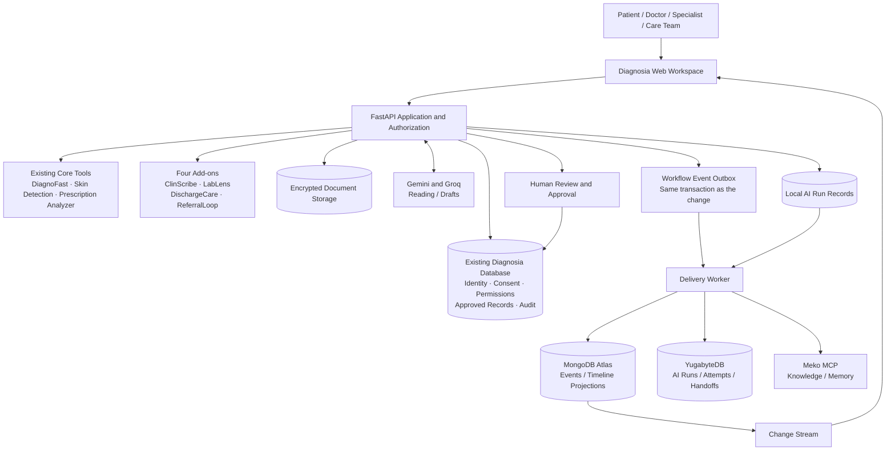
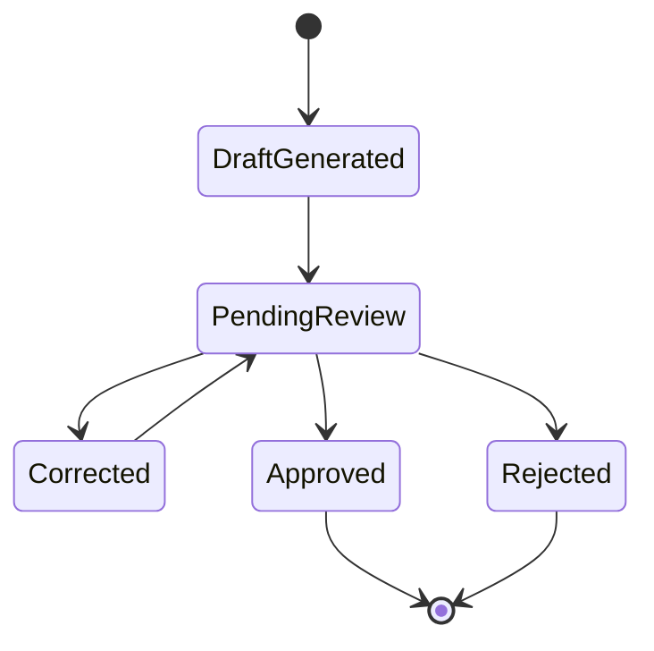

<p align="center">
  
</p>

<h1 align="center">Diagnosia</h1>

<p align="center">
  <strong>AI-powered care continuity for safer, more connected healthcare.</strong><br />
  A modular healthcare workspace connecting clinical information, specialist workflows, shared agent context and operational intelligence.
</p>

<p align="center">
  
  
  
  
</p>

<p align="center">
  <a href="#overview">Overview</a> ·
  <a href="#the-four-add-ons">Four Add-ons</a> ·
  <a href="#the-three-sponsor-integrations">Sponsor Integrations</a> ·
  <a href="#architecture">Architecture</a> ·
  <a href="#getting-started">Getting Started</a> ·
  <a href="#safety-and-readiness">Safety & Readiness</a>
</p>

> [!CAUTION]
> **PILOT ONLY — NO-GO FOR REAL PATIENTS.** Diagnosia is a development and hackathon prototype. Use synthetic data only. It is not approved for diagnosis, treatment decisions, clinical deployment or storage of real patient information. Passing software tests does not establish clinical validity, regulatory compliance or production security.

---

## Contents

- [Overview](#overview)
- [The problem](#the-problem)
- [Product scope](#product-scope)
- [Core Diagnosia tools](#core-diagnosia-tools)
- [The four add-ons](#the-four-add-ons)
- [The three sponsor integrations](#the-three-sponsor-integrations)
- [How the technologies work together](#how-the-technologies-work-together)
- [Architecture](#architecture)
- [End-to-end demonstration](#end-to-end-demonstration)
- [Data ownership and review lifecycle](#data-ownership-and-review-lifecycle)
- [Technology stack](#technology-stack)
- [Getting started](#getting-started)
- [Configuration](#configuration)
- [Running and testing](#running-and-testing)
- [Security and safety boundaries](#security-and-safety-boundaries)
- [Current readiness and known limitations](#current-readiness-and-known-limitations)
- [Project documentation](#project-documentation)
- [Final scope and contribution boundaries](#final-scope-and-contribution-boundaries)
- [Sponsor and technical references](#sponsor-and-technical-references)

---

## Overview

**Diagnosia is a connected healthcare workflow platform designed to help clinicians, specialists, patients and care teams manage information across the patient journey.** It brings patient intake, medical-document understanding, clinical documentation, laboratory reports, discharge coordination and specialist referrals into one shared patient-record experience.

The project combines three core clinical tools with four integrated add-on modules. For the MLH hackathon scope, three sponsor technologies extend the platform in clearly separated roles:

| Sponsor technology | Responsibility in Diagnosia |
|---|---|
| **Google Gemini API** | Multimodal understanding, structured extraction, summarization and controlled requests to existing backend functions |
| **YugabyteDB** | Technical records of AI runs, attempts and handoffs, in a database Diagnosia owns |
| **Meko** | Shared agent context: approved knowledge, memory and handoff notes |
| **MongoDB Atlas** | Workflow events and timeline projections for the CareFlow view |

The goal is not to create a collection of disconnected AI demos. Diagnosia is designed as one coordinated system: information enters through existing workflows, AI prepares reviewable drafts, authorized modules reuse relevant context, workflow events update the patient journey, and aggregated operational data helps clinics understand where coordination is getting delayed.

### At a glance

| | |
|---|---|
| **Product category** | Healthcare workflow and care-continuity platform |
| **Primary users** | Doctors, specialists, patients and care teams |
| **Core tools** | DiagnoFast, Skin Cancer Detection, Prescription Analyzer |
| **Add-on modules** | 8 focused workflows |
| **Accessibility companion** | OptiKinesis (separate assistive-computing application) |
| **Hackathon integrations** | Gemini API, YugabyteDB, Meko, MongoDB Atlas |
| **Backend foundation** | Python, FastAPI and the existing Diagnosia data/authentication layer |
| **Frontend** | HTML, CSS and JavaScript served by FastAPI |
| **Demo data policy** | Synthetic data only |
| **Readiness** | Pilot prototype; not approved for real-patient use |

## The problem

Healthcare information is fragmented across short consultations, handwritten prescriptions, laboratory documents, hospital discharge papers, specialist referrals and follow-up reminders. Even when individual tools work, the overall patient journey can still lose context between visits and care settings.

Diagnosia focuses on four connected problems:

1. **Information capture:** patient history and supporting documents need to be collected in a usable, structured format.
2. **Clinical workflow fragmentation:** notes, laboratory reports, prescriptions, referrals and care tasks are often handled in separate workflows.
3. **Continuity gaps:** follow-ups, discharge tasks and referrals can remain incomplete or unconfirmed.
4. **Operational visibility:** care teams need to understand review backlogs and workflow delays without turning operational analytics into unsupported clinical decisions.

Diagnosia is intended to assist and coordinate these workflows. It does not replace clinicians, pharmacists, laboratory professionals or other qualified healthcare staff.

## Product scope

The project scope is now **feature-frozen**. The final product consists of:

- The existing core Diagnosia tools.
- The four selected add-on modules described below.
- The three selected sponsor integrations.
- Shared platform capabilities required to connect, secure, observe and demonstrate those modules.
- One shared operational analytics view: the **Care Continuity Observatory**.

The Care Continuity Observatory is a platform-level analytics surface, **not a fifth clinical add-on**. No additional standalone healthcare tools are planned. Remaining development should focus on implementing the finalized integrations, closing technical gaps, validating existing workflows, improving reliability, documentation and review evidence—not expanding the product scope.

> **Implementation-status note:** the four add-ons have been built into Diagnosia and exercised end to end as pilots. Gemini, YugabyteDB, Meko and MongoDB integrations are built. See [the validation record](docs/integrations/EXTERNAL_INTEGRATION_VALIDATION.md) for exactly what has been proved against each real service.

## Core Diagnosia tools

These are the existing primary user-facing capabilities that form the foundation for the add-on workflows.

<details open>
<summary><strong>1. DiagnoFast — voice-first patient intake</strong></summary>

DiagnoFast helps collect a patient's history before or during a clinical visit. It is designed around conversational intake and structured preparation for the clinician.

**Existing workflow and technology**

- Voice-first patient history capture.
- Live browser speech recognition with an editable preview; Groq Whisper supplies a preview when live recognition is unavailable. Patients confirm each answer.
- Neural Indian English (Neerja) and Hindi (Swara) question playback through Edge-TTS, with Groq English and browser voice fallbacks.
- Six department choices, optional quick-answer chips, and a printable clinical requisition with source labels and physician workspace.
- AI-assisted extraction into structured intake fields and a concise clinician-facing draft.
- Intended support for Hindi and Indian English workflows.

**Self-service kiosk:** set `DIAGNOFAST_KIOSK_DOCTOR_ID` to the numeric user ID of a verified clinic doctor, restart the server, and open `/intake.html`. No patient links need to be created in advance. Visits enter that doctor's queue. Without this setting, reception-created links still work. The kiosk cannot attach existing charts or fetch ABHA history. Neural speech is enabled by default; set `DIAGNOSIA_NEURAL_TTS=0` to disable Microsoft question playback.

**Integration status**

Each interview step is recorded in CareFlow: the link, the start, each transcribed answer, completion and the report waiting for a doctor. AI runs are recorded with the provider that answered.

**Boundary:** patient statements remain patient-reported information until reviewed. DiagnoFast does not independently diagnose, triage or prescribe.
</details>

<details open>
<summary><strong>2. Skin Cancer Detection — image-based screening support</strong></summary>

The existing skin-image workflow uses a PanDerm-based visual representation with a classifier for eight lesion categories:

- Melanoma (`MEL`)
- Basal cell carcinoma (`BCC`)
- Squamous cell carcinoma (`SCC`)
- Actinic keratosis (`AK`)
- Benign keratosis-like lesion (`BKL`)
- Dermatofibroma (`DF`)
- Melanocytic nevus (`NV`)
- Vascular lesion (`VASC`)

The documented pipeline includes image preprocessing, classifier output, Grad-CAM visualization, calibration and out-of-distribution uncertainty handling. The workflow is intended for clinician review, not standalone patient diagnosis.

**Integration status:** the model boundary stays as it is. Gemini must not replace or overrule the skin model, generate a second unvalidated diagnosis or turn a model output into a clinical decision. CareFlow records that an analysis ran and needs review, and never records the finding.
**Boundary:** this module has an unresolved calibration test failure and requires a CDSCO/regulatory assessment and appropriate clinical validation before any real-world use.
</details>

<details open>
<summary><strong>3. Prescription Analyzer — prescription understanding and guidance</strong></summary>

The Prescription Analyzer helps interpret prescription images and explain readable instructions in a patient-friendly format.

**Existing safety design**

- Extracted fields are classified as `clear`, `unsure` or `unreadable`.
- A deterministic shorthand engine interprets common notation such as `1-0-1`, `OD`, `BD`, `TDS`, `AC`, `PC`, `HS` and `SOS`.
- The patient confirms candidate medication information before downstream explanation.
- Unclear instructions are surfaced for pharmacist/doctor confirmation.
- The system must not silently alter a dose, substitute a brand or recommend stopping a medication.

**Integration status:** Gemini is the first choice for reading prescription photos, and Groq is the fallback. Every medicine still needs the patient's confirmation. CareFlow records the steps and never the medicines.

**Boundary:** model extraction is not a verified prescription or medication order.
</details>

### OptiKinesis — accessibility companion

OptiKinesis is a related but separately distributed assistive-computing application. It uses webcam-based head tracking and blink interaction to help people with motor impairments control a computer. The documented technology includes MediaPipe facial landmarks, head-pose mapping, calibration, blink-to-click interaction and accessibility controls.

OptiKinesis is **not counted among the four Diagnosia clinical add-ons** and is not a diagnostic module. Its role in the broader project ecosystem is digital accessibility and hands-free computer interaction.

## The four add-ons

The four add-ons share the Diagnosia patient-record and workflow foundation. They are designed to exchange relevant, permission-controlled context rather than act as four unrelated applications.

| Add-on | Purpose | Main users | Primary output |
|---|---|---|---|
| **ClinScribe** | Clinical documentation and encounter summarization | Doctor, clinician | Structured note draft with source references and review state |
| **LabLens** | Laboratory report extraction and review | Patient, doctor, lab reviewer | Structured report draft with source and uncertainty metadata |
| **DischargeCare** | Discharge transition and post-discharge coordination | Hospital team, patient, care team | Discharge summary and candidate follow-up tasks |
| **ReferralLoop** | Specialist referrals and back-referral tracking | Referring doctor, specialist, care team | Referral status, appointment/consultation milestones and returned-note tracking |

<details>
<summary><strong>ClinScribe — AI clinical documentation</strong></summary>

ClinScribe turns clinician-entered information (text or voice transcript) into a structured encounter-note draft. Its role is to reduce repetitive documentation while keeping the clinician responsible for the final note.

**CareFlow:** records session, draft, review and sign-off steps, and names the model that drafted. ClinScribe drafts from the consultation transcript alone. It doesn't read lab results or shared context.

**Guardrail:** generated text stays a draft until the clinician reviews and approves it. The system must not invent an examination finding, diagnosis or treatment plan.
</details>

<details>
<summary><strong>LabLens — laboratory report digitisation and review</strong></summary>

LabLens extracts laboratory report content into structured, reviewable fields. The workflow is designed to retain the original source, preserve test names and values, and expose uncertainty for human correction.

**CareFlow:** records each report from receipt to confirmation. Text PDFs are read locally, and scanned reports by Gemini first, then Groq. Confirmed results become observations in the patient record.

**Current pilot limitations:** the parser has been exercised against synthetic layouts, not a representative real-world Indian laboratory dataset. The reported synthetic test set found 37/37 expected tests, but that is not a real-world accuracy claim. None of the 58 proposed LOINC mappings is approved; exports retain the laboratory's own test name rather than presenting an unreviewed mapping as verified.

**Guardrail:** extracted values remain drafts until reviewed. Do not infer missing values or silently normalize uncertain units.
</details>

<details>
<summary><strong>DischargeCare — discharge and transition coordination</strong></summary>

DischargeCare organizes discharge information and candidate post-discharge tasks so that a transition from hospital to home or another care setting has traceable next steps.

**CareFlow:** records the episode, checklist changes, approval and closure.

**Guardrail:** extracted tasks require human verification before becoming active care tasks. Summarization is not a substitute for discharge instructions or clinical review.
</details>

<details>
<summary><strong>ReferralLoop — specialist referral and back-referral tracking</strong></summary>

ReferralLoop tracks a referral from request through routing, scheduling, specialist encounter and return of a consultation note. It focuses on coordination and preventing referrals from silently falling through workflow gaps.

**CareFlow:** records every referral step from creation to closure, including contact attempts and priority changes.

**Guardrail:** referral urgency and clinical appropriateness remain decisions for qualified clinicians. Workflow analytics must not silently prioritize or deprioritize patients.
</details>

## The three sponsor integrations

Each has one job, and none replaces the Diagnosia database. All are optional, and off by default. Status as of the last validation is in [EXTERNAL_INTEGRATION_VALIDATION.md](docs/integrations/EXTERNAL_INTEGRATION_VALIDATION.md). Local stand-ins are never reported as these services.

### 1. Google Gemini API: reading documents

Gemini is the first choice for reading prescription photos, reading scanned lab reports, and explaining a prescription. If it's busy, a smaller Gemini model takes over, then Groq. Other tools use Groq first, with Gemini as a fallback. Output is checked against a schema and a person reviews it. Gemini has no function calling here, and can't request anything from the backend.

### 2. YugabyteDB and Meko: execution records and shared context

These are two separate things. **YugabyteDB** is Diagnosia's own database, holding technical records of each AI run, its attempts and each handoff, so nothing about a request depends on it. **Meko** holds approved knowledge and notes that a handoff happened, reached only through its documented MCP server. Its internal database is never touched.

Neither is a clinical record, and neither proves identity, consent or approval. A receiving tool always re-reads the source record.

### 3. MongoDB Atlas: the CareFlow timeline

Atlas stores one safe event for each workflow step and a prepared summary for each workflow. Events are written to a local outbox in the same transaction as the change they describe, then delivered, retried and deduplicated. Change Streams update open screens straight away, with a 15-second refresh as the fallback.

### Which tool uses what

| Tool | AI | CareFlow events | Handoff |
|---|---|---|---|
| DiagnoFast | Gemini first for confirmed-answer extraction; configurable fallback | Yes | None |
| Skin Cancer Detection | Local model | Yes, with no finding recorded | None |
| Prescription Analyzer | Gemini, then Groq | Yes | None |
| ClinScribe | Groq, then Gemini | Yes | None |
| LabLens | Gemini, then Groq, for scans | Yes | None |
| DischargeCare | None | Yes | None |
| ReferralLoop | None | Yes | None |

## How the technologies work together

Each layer does one job:

1. **AI reads and drafts:** Gemini or Groq returns structured candidates, checked against a schema.
2. **Diagnosia validates:** permissions, consent and workflow rules are applied, and the result is saved as a draft.
3. **A person reviews:** clinical content stays pending until an authorized person approves it.
4. **The outbox records it:** an event commits in the same transaction as the change.
5. **MongoDB shows the journey:** the worker delivers the event, and CareFlow's timeline updates.
6. **YugabyteDB and Meko keep the rest:** technical AI and handoff records go to YugabyteDB, and handoff notes to Meko.

## Architecture



### Data ownership rules

| Data category | Authoritative owner | Role of sponsor technology |
|---|---|---|
| Accounts, sessions, staff verification | Existing Diagnosia database | No sponsor database becomes the identity authority |
| Patient identity, consent and care-team access | Existing Diagnosia database | Meko, Atlas and YugabyteDB must not override access decisions |
| Approved clinical records and audit events | Existing Diagnosia database | Gemini creates drafts, Meko supplies context, and Atlas holds workflow projections |
| Original clinical document | Diagnosia encrypted document storage | Never copied to Gemini for keeping, or to Meko, Atlas or YugabyteDB |
| Shared agent context | Meko, bounded by Diagnosia authorization | Context retrieval and agent handoffs |
| Workflow timeline | MongoDB Atlas projection | Flexible event persistence and Change Streams |
| AI run, attempt and handoff records | Local run records, copied to YugabyteDB | Technical metadata only |
| AI inference | Gemini API | Inference only; no authority to approve clinical records |

### Why the separation matters

Putting the same patient data into every system would create conflicting sources of truth, duplicate retention obligations, difficult deletion workflows and more places where sensitive data could be exposed. Each system therefore has one defined responsibility. The existing Diagnosia database remains the authority for identity and approved records; the sponsor systems extend context, event tracking and analytics.

## End-to-end demonstration

The demo uses one clearly synthetic case, `case_demo_001`, and goes through the real routes.

```bash
.venv/bin/python -m backend.operator_cli careflow-demo             # fixed answers, no AI cost
.venv/bin/python -m backend.operator_cli careflow-demo --real-ai   # real Gemini and Groq, synthetic data
```

Sign in as `careflow.demo.doctor@example.com` with `Synthetic-demo-only-1`, and open **CareFlow**.

1. **DiagnoFast** runs an interview, and its report waits for a doctor.
2. **LabLens** reads two text reports locally and a scanned one with Gemini. The AI run goes to YugabyteDB.
3. **DischargeCare** opens a discharge episode, and **ClinScribe** drafts a note that waits for a clinician.
4. **ReferralLoop** follows a referral to a booked appointment.
5. **Failure and recovery:** run `python -m backend.tests.local_stack.end_to_end`, which interrupts a destination and shows recovery with no duplicates.

CareFlow shows all of this in order, says which store it came from, and updates without a reload.

## Data ownership and review lifecycle

All AI-generated clinical content follows a review lifecycle. The exact state names should match the implementation, but the conceptual process is:



- **Draft generated:** model output is stored with provider, timestamp, model/version where available, source reference and extraction metadata.
- **Pending review:** the UI clearly marks the information as unreviewed.
- **Corrected:** a human edits a candidate field; the correction remains attributable.
- **Approved:** an authorized reviewer accepts the information under the existing workflow.
- **Rejected:** an unsuitable or incorrect draft is retained/handled according to the applicable audit and retention policy, not silently promoted.

The current implementation reports that unreviewed material is highlighted and excluded from the approved record and FHIR exports. Keep this backend-enforced; a frontend badge alone is not a safety control.

## Technology stack

The stack as implemented.

| Layer | Technology | Responsibility |
|---|---|---|
| Backend API | Python, FastAPI | Application endpoints, workflow orchestration and authorization |
| Data validation | Pydantic | Request/response schemas and validation |
| Existing database | SQLite in the documented development setup; configured through `DIAGNOSIA_DB` | Existing accounts, sessions and patient/workflow records |
| Data access | Plain `sqlite3` with parameterised SQL | Persistence |
| Frontend | HTML, CSS, JavaScript | Landing pages, auth, dashboards and care workspace |
| Clinical image pipeline | PanDerm-based visual representation, PyTorch and scikit-learn classifier components | Existing skin-image workflow |
| Language models | Google Gemini and Groq, with fallback | Structured extraction, drafting and reading |
| Speech | Edge neural questions, Groq Whisper/Orpheus, browser speech | Voice interview, transcript preview and read-aloud |
| Shared context | Meko, through MCP | Approved knowledge, memory and handoff notes |
| Execution records | YugabyteDB, through YSQL | AI runs, attempts and handoffs |
| Workflow event store | MongoDB Atlas | Events and CareFlow timeline projections |
| Document protection | AES-256-GCM encrypted document storage | Protect uploaded reports and documents at rest |
| Authentication security | Argon2id password hashing, hashed session tokens and HttpOnly cookies | Credential and session protection |

Exact versions and final deployment topology should be taken from the repository's dependency and environment files rather than inferred from this overview.

## Getting started

> These instructions describe the documented local development setup. Use synthetic data only. Some optional integrations require credentials and a configured service endpoint.

### Prerequisites

- Python 3.12 recommended (Python 3.11 may be supported by the project dependencies).
- [`uv`](https://docs.astral.sh/uv/) for Python environment and dependency management.
- Git.
- A browser such as Chrome for the local workspace.
- Optional API/service credentials for integrations being tested.

### 1. Clone the repository

Replace the placeholder with the repository URL provided by the project owner.

```bash
git clone <YOUR_DIAGNOSIA_REPOSITORY_URL>
cd diagnosia
```

### 2. Create the environment and install dependencies

```bash
uv venv .venv --python 3.12
source .venv/bin/activate
uv pip install -r backend/requirements.txt
```

On Windows PowerShell, activate the environment with:

```powershell
.venv\Scripts\Activate.ps1
```

### 3. Configure environment variables

```bash
cp .env.example .env
```

Open `.env` and configure only the services required for the workflow you are testing. See [Configuration](#configuration). Never commit `.env`, API keys, database credentials or document-encryption keys.

### 4. Generate the document-encryption key

Document uploads require the configured encryption key. Generate a local key file using the operator CLI:

```bash
.venv/bin/python -m backend.operator_cli generate-key --path ~/.diagnosia/document-keys.json
```

Set `DIAGNOSIA_DOCUMENT_KEY_FILE` in `.env` to that file path. Store a protected backup separately from the repository and test the recovery procedure. **Losing the key can make encrypted documents permanently unreadable.** Do not share the key or add it to Git.

Uploads should fail closed when the key is missing or invalid.

### 5. Bootstrap the first organization administrator

Public doctor registration does not make a staff account verified. The first organization administrator must be provisioned through the documented server-side operator workflow.

Inspect the available commands and their exact arguments with:

```bash
.venv/bin/python -m backend.operator_cli --help
.venv/bin/python -m backend.operator_cli bootstrap-organization --help
```

Follow the operator documentation in the repository. Do not invent or bypass staff verification.

### 6. Start Diagnosia

```bash
.venv/bin/uvicorn backend.app:app --host 127.0.0.1 --port 8001 --reload
```

Open the local care workspace:

**[http://127.0.0.1:8001/care.html](http://127.0.0.1:8001/care.html)**

The landing page is available at `http://127.0.0.1:8001/` when served by the documented static frontend setup.

## Configuration

The environment file is local-only. The following keys are documented in the existing project material; check `.env.example` and `backend/config.py` for the exact current supported names and defaults.

| Variable | Purpose | Notes |
|---|---|---|
| `GROQ_API_KEY` | Groq AI and speech | Do not send real patient data; vendor approval is outstanding |
| `GEMINI_API_KEY` | Gemini AI | Do not send real patient data; vendor approval is outstanding |
| `DIAGNOSIA_HTTPS` | Secure-cookie/deployment setting | Configure correctly for the environment; do not expose the app publicly by accident |
| `DIAGNOSIA_DB` | Existing database path | Defaults and actual path are defined by `backend/config.py` |
| `DIAGNOSIA_DOCUMENT_KEY_FILE` | Document encryption key file | Keep outside the repository; back up separately and securely |

MongoDB Atlas, YugabyteDB and Meko are built, optional and off by default. See [the setup guide](docs/integrations/SETUP.md). Their variables are in
`.env.example`, and setup is in [docs/integrations/](docs/integrations/ARCHITECTURE.md). CareFlow works
with none of them, from a local outbox. For a repeatable synthetic journey, run
`.venv/bin/python -m backend.operator_cli careflow-demo`, then sign in as
`careflow.demo.doctor@example.com` with `Synthetic-demo-only-1` and open CareFlow.

No tool produces a handoff today. The support for handoffs between tools (events with a target module, the YugabyteDB
handoff records and the Meko notes) stays in the code, and is tested with synthetic events, for a future tool to use.

Gemini configuration must use the exact variable names and connection settings implemented in the relevant integration adapters and `.env.example`. This README intentionally does not invent names or credentials. Keep service-specific secrets in environment variables or an approved secret manager.

## Running and testing

Run the repository's normal automated test suite from the project root:

```bash
.venv/bin/pytest -q
```

The skin-model tests require a separate environment with the optional Torch/model dependencies installed. Follow the repository's skin-model test instructions; do not weaken or skip the calibration assertion to make the suite appear green.

### Last reported test evidence

The following results were reported at the time this README was prepared. Re-run the tests after code changes; these are not a guarantee of the current checkout state.

| Test area | Last reported result | Important qualification |
|---|---:|---|
| Main automated suite | **1,121 passed** | Run on 1 November 2026, after removing four tools, without the skin suite. Synthetic/unit/integration coverage; not clinical validation |
| Skin model suite | **21 passed** | Run in a separate environment with Torch. The trained model itself isn't on this machine yet |
| Chrome microphone workflow | **30/30 passed** | Used a fake audio device, not a real microphone |
| Full Chrome workflow | No page/server errors reported | Synthetic test data; phone-width layout also checked |
| CareFlow in Chrome | **19/19 passed** | Local MongoDB, not Atlas. Reported before the four tools were removed, and not re-run since |
| YugabyteDB live | **7 passed** | A real server in Docker, not a cloud cluster |
| MongoDB Atlas and Meko live | **Not run** | `BLOCKED_MISSING_CREDENTIALS` |

Not yet demonstrated in the reported test run:

- Real microphone recording and real speech on real devices.
- MongoDB Atlas and Meko themselves, which need credentials.
- Safari and Firefox compatibility.
- SMS or automated voice reminders.
- Validation against real Indian laboratory reports or representative external datasets.
- Independent penetration testing.

## Security and safety boundaries

Diagnosia incorporates safeguards in its pilot implementation, including:

- Password hashing using Argon2id.
- Hashed session tokens and HttpOnly session cookies.
- Staff accounts beginning in a pending-verification state; verification requires an administrator of a verified organization.
- Consent enforcement and immediate effect of revocation in the documented workflows.
- Audit events designed to be tamper-resistant, with patient-visible record-access history.
- AES-256-GCM document encryption, with uploads refused when the required key is unavailable.
- Unreviewed AI output visibly marked and excluded from approved clinical records and FHIR exports.
- Cross-organization/cross-site access restrictions.
- Pilot-mode controls that prevent real-patient operation until readiness requirements are satisfied.

These controls reduce risk but do not establish regulatory compliance or production security. Configuration, deployment, independent testing and professional review remain necessary.

## Current readiness and known limitations

**Latest reported assessment: NO-GO for real patients.** All 10 required human sign-offs are outstanding, and the readiness checks fail until they are recorded. Run `python -m backend.operator_cli readiness` for the current count. Use `docs/DIAGNOSIA_READINESS_REPORT.md` as the detailed source of truth and update it as evidence changes.

| Area | Current known state |
|---|---|
| Overall deployment | Pilot only; synthetic data only |
| LOINC | 58 proposed mappings remain unapproved; local laboratory test names are retained in exports |
| Reminders | In-app/staff follow-up workflow; SMS and voice channels are not connected |
| Skin model | One calibration test remains failed and requires model-owner investigation |
| Staff security | MFA and password-reset work remain open in the latest reported review |
| Patient rights workflows | Whole-record export and erasure workflows remain open in the latest reported review |
| Security assurance | Independent penetration test remains outstanding |
| Vendors | Groq, Gemini, Atlas and Meko data terms require approval before any real data |
| Privacy/regulation | DPDP and CDSCO assessments, notices and legal review remain open; generic FHIR is not ABDM compliance |
| Lab validation | Synthetic report layouts only; real Indian lab formats have not been validated |

### Human approvals are not software features

Clinical validation, laboratory terminology review, CDSCO/regulatory advice, privacy/legal approval, AI vendor agreements and independent security assessment require qualified external people or organizations. Passing tests or generating a sign-off form does not satisfy those requirements.

## Project documentation

The repository's `docs/` directory contains the detailed implementation and governance material. Start here:

| Document | Purpose |
|---|---|
| [`docs/DIAGNOSIA_READINESS_REPORT.md`](docs/DIAGNOSIA_READINESS_REPORT.md) | Current go/no-go status, readiness checks, test evidence and human sign-offs |
| [`docs/CLINICAL_GOVERNANCE.md`](docs/CLINICAL_GOVERNANCE.md) | Clinical safety boundaries, review requirements and governance decisions |
| [`docs/SECURITY_REVIEW.md`](docs/SECURITY_REVIEW.md) | Security findings and remaining technical work |
| [`docs/PRODUCTION_READINESS_AUDIT.md`](docs/PRODUCTION_READINESS_AUDIT.md) | Hardening-sprint audit and technical findings |
| [`docs/DATA_PROTECTION_AND_RETENTION.md`](docs/DATA_PROTECTION_AND_RETENTION.md) | Document protection, privacy and retention considerations |
| [`docs/PRODUCTION_DEPLOYMENT_CHECKLIST.md`](docs/PRODUCTION_DEPLOYMENT_CHECKLIST.md) | Deployment prerequisites and readiness controls |
| [`docs/addons/`](docs/addons/) | One detailed document for each of the four add-ons |
| [`THIRD_PARTY_NOTICES.md`](THIRD_PARTY_NOTICES.md) | Third-party acknowledgements, reused material and license notices |

If a linked document is absent in a particular branch or release, treat the link as a documentation task rather than assuming the requirement has been met.

## Final scope and contribution boundaries

The product scope is frozen at the three core clinical tools, four add-ons, OptiKinesis companion and three selected sponsor integrations. Please do not add another standalone module, chatbot, diagnostic engine or parallel patient database.

Useful contributions within the approved scope include:

- Completing and testing the three selected sponsor integrations.
- Fixing defects and improving reliability without weakening safety checks.
- Improving provenance, review workflows, permission enforcement and auditability.
- Strengthening automated tests and reproducible synthetic demo scenarios.
- Improving accessibility, documentation, deployment repeatability and observability.
- Resolving readiness blockers and preparing evidence for qualified reviewers.

Before making changes, inspect `git status` and preserve existing uncommitted work. Never commit secrets, patient information, encryption keys or local database files.

## Sponsor and technical references

### Selected sponsor technologies

- [Google Gemini API documentation](https://ai.google.dev/gemini-api/docs)
- [Gemini document processing](https://ai.google.dev/gemini-api/docs/document-processing)
- [Gemini structured output](https://ai.google.dev/gemini-api/docs/structured-output)
- [Gemini function calling](https://ai.google.dev/gemini-api/docs/function-calling)
- [Meko documentation](https://docs.mekodata.ai/)
- [Meko architecture](https://docs.mekodata.ai/architecture/how-meko-fits/)
- [Meko MCP server reference](https://docs.mekodata.ai/reference/mcp-server/)
- [MongoDB Atlas](https://www.mongodb.com/atlas)
- [MongoDB Change Streams](https://www.mongodb.com/docs/manual/changestreams/)
- [YugabyteDB YSQL](https://docs.yugabyte.com/stable/api/ysql/)

### MLH student resources supplied with the track description

- [MongoDB student credit](https://mlh.link/mongodb)
- [MongoDB Atlas free tier](https://mlh.link/mongodb-free)
- [MongoDB University resources](https://mlh.link/mongodb-university)

### Existing technology references

- [FastAPI](https://fastapi.tiangolo.com/)
- [Pydantic](https://docs.pydantic.dev/)
- [MediaPipe](https://ai.google.dev/edge/mediapipe/solutions/vision/face_landmarker)
- [Groq](https://console.groq.com/docs)
- [ABDM FHIR Implementation Guide](https://www.nrces.in/ndhm/fhir/r4/)

---

<p align="center">
  <strong>Diagnosia</strong><br />
  Connecting clinical information, care workflows and operational insight.<br />
  <sub>Built for a synthetic-data hackathon pilot. Human review remains essential.</sub>
</p>
