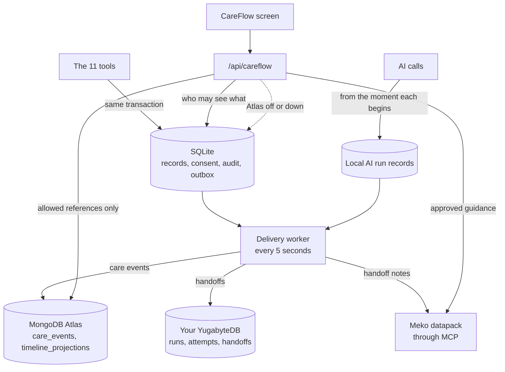
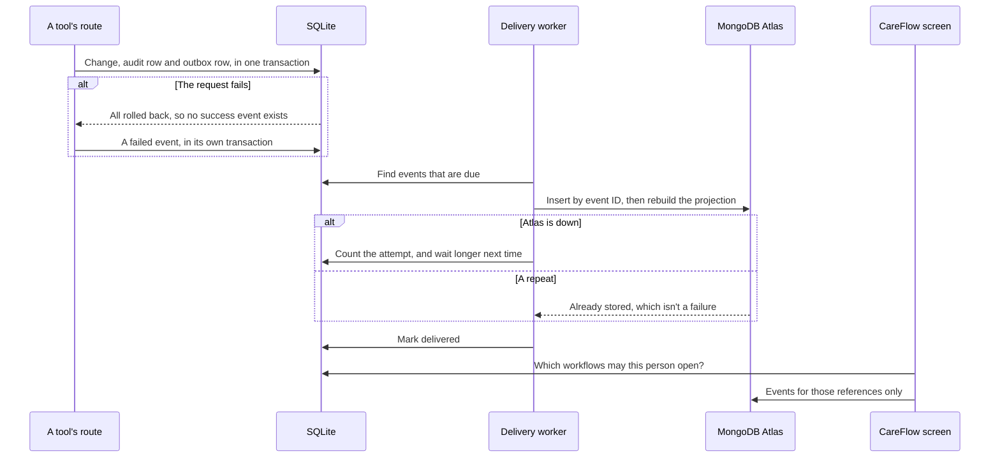

# Integration architecture

Each integration is optional and off by default. With none switched on, the app runs as before, and
CareFlow reads from its local outbox and says so on screen.

## What each one does

- **MongoDB Atlas** holds one safe event per step and a prepared summary for each workflow. It's
  what CareFlow reads. It decides nothing.
- **YugabyteDB** holds how AI calls ran: which provider and model, how long, and when a fallback
  was needed, plus a record of each handoff. It's your own cluster, and only the worker talks to
  it, so it can't slow or break a clinical request.
- **Meko** holds shared knowledge for agents, and notes that a handoff happened. Knowledge is loaded through its documented tools. A receiving tool
  always re-reads the source record. Meko's own internal database is never connected to.
- **SQLite** stays the record, and the only thing that decides access.

## An event's journey

## Delivery

Delivery is at least once, and destinations ignore repeats, so a retry can't create a duplicate.
Exactly-once across separate systems isn't possible, and isn't claimed.

- Each destination has its own queue, so one being down doesn't delay another.
- Waits double from 30 seconds up to an hour. After 8 failures an event is marked dead, stays
  visible, and can be queued again with `operator_cli careflow-replay`.
- Only an error's type is stored, because its text can hold an address or a password.
- AI run records are durable too. They're written when a run begins, in their own small SQLite file,
  because a request holds the main database's write lock while the AI works. See [YUGABYTEDB.md](YUGABYTEDB.md).

## Live updates

With `ENABLE_MONGODB_CHANGE_STREAMS=1`, a background thread watches `care_events` and tells open screens
to reload, through server-sent events. The message says only that something changed, and the screen then
asks again through the normal route, which checks access. A lost connection resumes from its last token,
or starts fresh if that token has expired. Every screen also refreshes every 15 seconds, so if streams
aren't available, an update takes up to 15 seconds instead of about one.

## Why the projection is rebuilt

An incrementing counter goes wrong when an event is retried or arrives late. Rebuilding the summary
from stored events after each insert gives the same answer whatever the order, and also repairs a
crash between the two writes.

## Decided against

| Left out | Why |
|---|---|
| Kafka, Debezium, Atlas Stream Processing | Nothing here needs them |
| Vector search in YugabyteDB | Meko already does retrieval, and a second embedding store would have no clear job |
| An `integration_agent_tasks` table | Runs and attempts cover what happens. Delivery state already lives in the outbox |
| `ai_drafts` in MongoDB | Nothing needs it, and draft text belongs in the Diagnosia database |
| Meko context in clinical prompts | It would change clinical behaviour, which is out of scope |
| A second delivery system | SQLite's outbox decides what's sent. MongoDB's `integration_delivery` is only a view of it |

## Safety

- With `ALLOW_REAL_PATIENT_DATA` on, CareFlow records nothing and sends nothing. These stores have
  no agreements in place, so this is deliberate, and needs a real decision before it changes.
- Events have no free-text fields. Unknown fields, and metadata outside the allowlist, are refused.
- Access is checked against SQLite on every request, and revoking care-team access works at once.
- Skin findings, lab values, medicine names and note text never enter an event.
